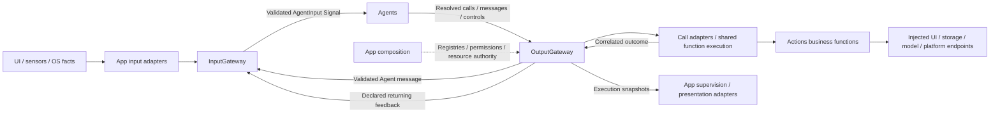
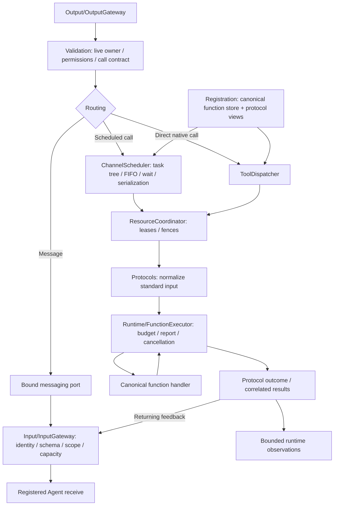

# Gateway — Signal Routing and Authorized Execution

Gateway connects external inputs, Agent communication and permitted effects. InputGateway validates and admits Signals; OutputGateway validates resolved outputs, schedules execution and correlates feedback. It owns transport and execution coordination, while Agents own meaning and business decisions.

Design goals: trusted identity, explicit permissions, bounded admission, shared function execution and joined cancellation without silent loss of device work.

## Upstream and downstream

Arrows show runtime flow; dashed arrows show App assembly. Foundational SDK calls are ordinary capability calls and do not pass through Gateway.

Signals use the common AgentInput envelope and typed provenance. Calls are OutputEnvelope execution requests; their feedback becomes input. Admission is not processing or physical completion.

## Internal structure

This diagram shows processing inside Gateway; scheduling applies to ActionCall and explicitly scheduled native bindings. Direct native calls use the shared executor without Channel admission.

✅ [ActionCall / ToolCall routing](Output/Protocols/README.md#protocol-selection-one-function-two-call-paths) documents registration, Agent transport/parsing, Gateway dispatch, shared execution and result feedback. One callable function can use both protocols; ToolCall can also use shared scheduling.

Cancellation and terminal controls join admitted work and cooperative cleanup before releasing its ownership. Feedback delivery retries do not repeat an effect. Completion-only calls return an execution outcome without injecting ToolResult.

## Design principles and core mechanisms

**Authority is bound, not inferred.** External adapters, identity-bound Agent messaging and execution owners supply Signal origin and scope. Payload content cannot assign permissions. InputGateway checks schema/source/session/deadline/capacity; OutputGateway checks live producer identity and grants before effects. It accepts resolved calls and never interprets business aliases or decides the next task.

**A call protocol is not a business implementation.** The same function can have independent scheduled/native bindings. Native ToolCall is not inherently direct: its registered policy may project into the ordinary scheduler.

| Concern | ActionCall | ToolCall |
| --- | --- | --- |
| Agent/model parsing | Text tags resolve inside Agents | Complete native events resolve inside Agents |
| Invocation policy | Channel/task/wait scheduling | Explicit direct or scheduled binding; scheduled calls share the same fences/cleanup |
| Business execution | Standard FunctionInput and shared FunctionExecutor | The same standard input and executor |
| Feedback | Declared Action/lifecycle feedback | Returning ToolResult or completion-only execution outcome |

Fixed Agent code may also emit already-resolved ActionCall/ToolCall; model parsing is not required for deterministic intent handling.

**Ordering, exclusion and ownership are separate.** FIFO belongs to a Channel within one task; wait gates its parent continuation. A function's serialization key excludes conflicting work across Channels/tasks. ResourceCoordinator separately guards declared resources using leases and live execution permits. Owning a resource does not describe device health. Handoff cancels/joins old writers before granting the next owner; a cleanup timeout does not falsely unlock a writer still running.

**Effect success and delivery success are separate.** Receipts retain call/execution/session correlation; a failed feedback admission does not authorize replaying an already completed effect. Completion-only presentation produces no returning Signal. Runtime observation snapshots expose actual accepted work/failures without becoming unregistered business commands.

## Ownership and compilation

| Location / target | Responsibility | Project dependencies |
| --- | --- | --- |
| `Input/`, Output orchestration / Gateway | Signal admission, output authorization, routing, queues, resources and feedback | AgentCore, FunctionContracts, ExecutionRuntime, CallRuntime |
| `Runtime/` / ExecutionRuntime | FunctionRegistry/FunctionExecutor, report storage, deadlines and cleanup | FunctionContracts |
| `Output/Registration`, `Output/Protocols` / CallRuntime | Binding views and scheduled/native protocol adapters | FunctionContracts, ExecutionRuntime |

Gateway never imports concrete Actions, UI, ModelKit, PlatformKit or App. App freezes one function catalog and supplies bindings; Gateway validates startup coverage. AgentCore remains independent. Business alias resolution belongs in Agents.

## Bounds and completion

- InputGateway: 128 concurrent admissions, 256 branches, 8 MiB observation bytes and at most 16 recipients per input; excess rejects. It has no waiting Signal FIFO.
- Bound messaging: at most 16 concurrent emissions per source; excess rejects.
- ChannelScheduler: 32 unfinished Actions per Channel name across tasks, 16 live names, 64 tracked tasks, 120 Actions and 32 waits per task; excess rejects. FIFO is task-local; exclusion uses definition-owned serialization keys.
- Registrations: common functions max 256; scheduled bindings max 256 and native bindings max 128, with max 32 modules per projection. Duplicate/invalid metadata fails startup.
- Output failure history is a 100-record ring with explicit eviction count; max 8 observers receive newest-one complete snapshots. Other resource/result bounds are documented in their owning directories.

## Implementation status

✅ Unified provenance, bound Agent messaging, shared function execution, distinct protocol views, task-local wait/Channel scheduling, resource fences and bounded feedback/observations.

❌ Complete original-root propagation for Action/activity feedback, generic activity subscriptions, priority scheduling and durable feedback/history remain outstanding. Physical stop acknowledgment is outside the software cleanup contract.

Details: [Input](Input/README.md), [Output](Output/README.md), [Runtime](Runtime/README.md), [Registration](Output/Registration/README.md), [Protocols](Output/Protocols/README.md), [Scheduling](Output/Scheduling/README.md), [Resources](Output/Resources/README.md) and [Results](Output/Results/README.md).

✅ Invocation failure isolation preserves complete shared reports before protocol feedback. Ordinary handler failure cannot stop sibling or subsequent work; explicit cancellation and admission errors keep their existing scopes.
