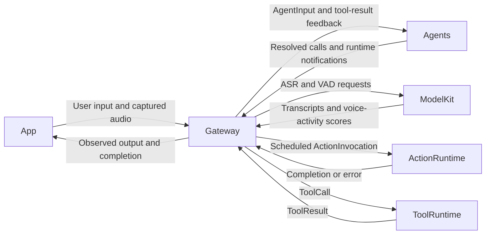

# Gateway — Input and Output Boundaries

Gateway connects external input, cognitive processing, and execution. Architecture sections 4–5 and 25–27 define two complementary paths: Input Gateway adapts and routes signals; Output Gateway validates and dispatches resolved calls.

## Responsibilities and boundaries

- Input receives user input, audio, and tool results, performs supported adaptation, and selects Agent destinations.
- Output accepts resolved `ActionCall` and `ToolCall` values. XML parsing, local alias resolution, and Channel selection happen inside Agents using AgentCore.
- Action Calls enter bounded Channel scheduling. Calls within one Channel are serial; independent Channels may run concurrently, subject to shared module resource exclusion.
- Tool Calls bypass Channel scheduling. Results re-enter through InputGateway with the originating session and Agent association.

## Direct relationships

Arrows show current logical payload flow. Platform input is connected through App; concrete Actions and Tools are reached through their runtimes.

## Implementation status

- ✅ [Input](Input/README.md): InputGateway, voice sessions, ASR/VAD adaptation, SignalRouter protocol, and LogicRouter.
- ✅ [Output](Output/README.md): validation, execution routing, action/tool dispatch, and bounded Channel scheduling.
- ✅ Per-Channel FIFO, module exclusion, explicit overflow rejection, and input/session cancellation and completion barriers.
- ✅ Dependencies on ActionRuntime and ToolRuntime; concrete implementation handlers are registered by App.
- ❌ Unified `Signal`, general context enrichment, JEV/Agentic routing, ActionResult feedback, priorities, preemption, and generic resource declarations.

The current input contract is `AgentInput`. `control` is a temporary runtime completion/error notification, not a third model output protocol. `main` has ordinary Channel semantics; it does not block every other Channel. See [Scheduling](Output/Scheduling/README.md) for limits and cancellation behavior.

## Maintenance

Keep this README synchronized with changes to responsibilities, files, interfaces, and implementation status. ✅ means implemented; ❌ means planned or incomplete. Do not create unused placeholder modules. The [technical architecture](../README.md) defines the target; the [layout audit](../../docs/Repository-Structure.md) records implementation exceptions.

✅ Voice input uses LiveSpeechInput and stream-only VAD events; final text enters through submit once per turn.
