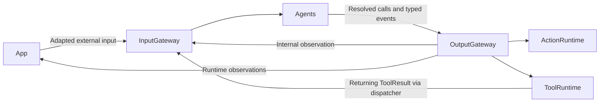
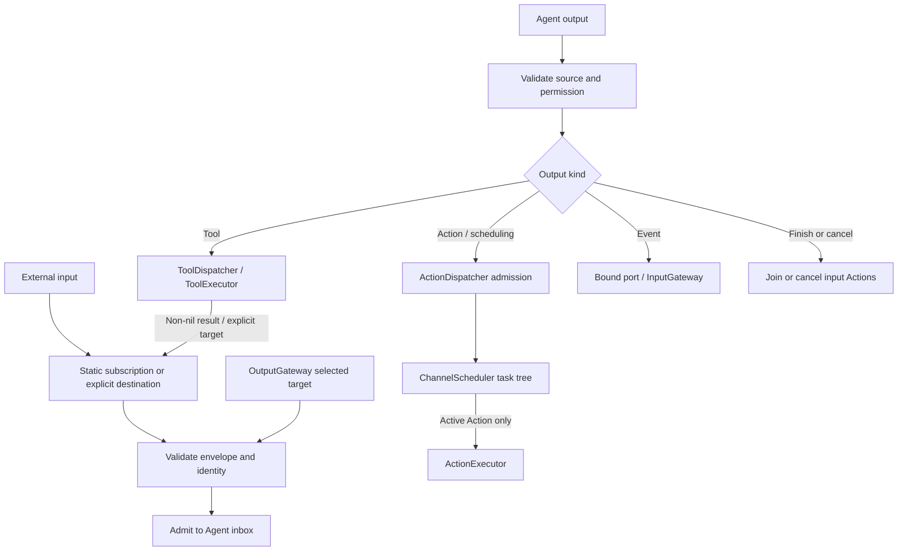

# Gateway — Input and Output Routing

Validates and routes Agent input, communication and resolved calls. The goal is bounded admission, explicit failure and clear completion semantics. The target depends only on AgentCore, ActionRuntime and ToolRuntime; model processing belongs to Agents.

## Directory structure

```text
Gateway/
├── Input/
│   └── InputGateway.swift            # Validation, static subscriptions and explicit delivery
├── Output/
│   ├── OutputGateway.swift           # Output dispatch and bound event ports
│   ├── Validation/                   # Capability and call validation
│   ├── Routing/                      # Select Action, scheduling, Tool or control path
│   ├── Dispatch/                     # Invoke runtimes and return Tool results
│   └── Scheduling/                   # Task-local wait groups, Channel FIFO and module exclusion
└── README.md                         # Module boundary and status
```

## Upstream and downstream

Arrows show runtime data flow. ModelKit and PlatformKit are not Gateway dependencies.



## Internal flow



Input admission reports acceptance, not Agent processing completion. Action dispatch waits for queue admission; finish controls join admitted Actions. Tool dispatch awaits execution and any result delivery. App observers supervise runtime state and capture admission; they do not turn events into UI commands.

| Owner | Default bound and overflow |
| --- | --- |
| InputGateway | 128 concurrent admissions shared by external/internal calls, 256 branches, 8 MiB observation bytes, up to 16 targets each; reject excess |
| OutputGateway event port | 16 concurrent emissions per source; reject excess |
| ChannelScheduler | 32 unfinished Actions per Channel name across tasks, including running/dormant work; 16 live names, 64 tracked tasks, 120 Actions and 32 waits per task; reject excess |

Each active task phase runs FIFO per Channel and shares process-wide Action-module exclusion. Different Channels may run concurrently when modules permit; equal names in separate tasks do not share a FIFO. Wait gates only its parent continuation. Cancellation joins cooperative handlers. Discrete events and Actions are never silently replaced; only Agent-owned declared latest-state buffers coalesce pending state. Gateways do not queue signals. See [Input](Input/README.md), [Output](Output/README.md) and [Scheduling](Output/Scheduling/README.md) for detailed contracts.

## Feature status

- ✅ Static JSON v5 subscriptions via publish and explicit directed delivery via send, source/session validation and admission receipts. No legacy router or implicit Assistant fallback remains.
- ✅ Action scheduling, direct Tools, event transport and completion/cancellation barriers.
- ❌ Request/reply, dynamic subscriptions, ActionResult feedback, priorities and preemption.
- ❌ Enforced Channel locks and physical control arbitration; current lock metadata grants no ownership.

## Issue record

| Status | Issue / next step |
| --- | --- |
| Open | Cleanup depends on cooperative handlers; device stop acknowledgements require future adapters. |


✅ ADR 0059 adds task-local nested wait groups. Ordinary Channel FIFO order is scoped to a task/active phase, while name capacities and module exclusion are process-wide. Typed scheduling directives pass through validation/routing/dispatch; no XML enters Gateway. ❌ Cross-task barriers and preemption remain unsupported.
