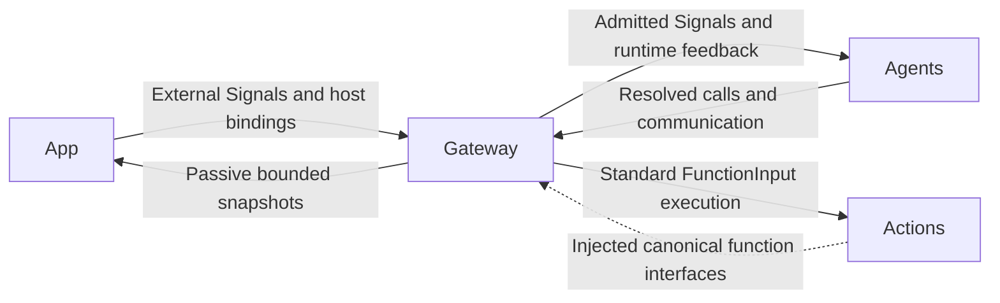
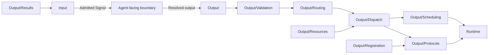

# Gateway — Signal Admission and Authorized Execution

## Summary

Validates Signal transport and resolved output, coordinates execution and returns owner-directed evidence.

## Ownership and boundaries

Gateway owns authority/admission/routing/execution coordination; Agents owns business meaning and alias resolution. Gateway imports AgentCore, FunctionContracts, ExecutionRuntime and CallRuntime, never concrete Actions, UI, ModelKit, PlatformKit or App. Foundation calls inside an Agent do not pass through Gateway.

## External relationships and data flow

Runtime arrows show data or capability calls; dashed arrows show injection.

## Internal structure

## Public interfaces and protocol policy

InputGateway validates external/Agent/runtime provenance, source/session/schema/deadline and bounds. External production input uses publish and exact static subscriptions. OutputGateway validates the bound actor/incarnation and permissions before calling functions, communicating or scheduling. Source authority cannot come from payloads.

| Protocol | Execution | Feedback |
| --- | --- | --- |
| ActionCall | Task-local Channel/wait scheduling and definition-owned serialization | Declared terminal/failure feedback; every generated call has round evidence |
| ToolCall | Direct shared execution; scheduled native bindings reject | Returning feedback or deterministic completion-only outcome; generated calls retain terminal evidence |
| CommunicationAction send | Directed live-target admission | Correlated receipt, distinct from task result |
| CommunicationAction publish | Bounded one-way fan-out | No subscriber or observer receipt |

Both call protocols use the same canonical FunctionExecutor, budgets, reports and resource authority. Fixed code may use either. A handler failure ends that call and advances eligible work; structural/admission/identity failures have task-scoped cleanup. Completed effects are never replayed on delivery failure.

## Ordering and lifetime

Channel FIFO, definition serialization keys and resource ownership are distinct. Wait groups gate only their own task tree; native Tools are outside wait. Resource handoff joins old writers before granting new authority and retains unfinished cleanup after timeout. Device health is independent of occupancy.

Output consumers bind actual Agent instances before reading. Task grants authorize effect execution; terminal runtime controls may finish after grant retirement while still validating real producer/session. Round sealing joins both transports, scheduled execution and scoped feedback before continuation acknowledgment.

## Compilation

Gateway contains Input and Output orchestration. Runtime compiles as ExecutionRuntime (FunctionContracts only); Output/Registration and Protocols compile as CallRuntime (FunctionContracts/ExecutionRuntime). Host assembly supplies catalogs and endpoints; startup coverage validates them separately from effect correctness.

✅ Bound provenance, direct/queued protocol separation, bounded feedback and passive observations are implemented.

❌ Durable transport/results, global fairness scheduling and hardware stop acknowledgment are not implemented.

## Related design

[Parent design](../README.md) · [Input](Input/README.md) · [Output](Output/README.md) · [Runtime](Runtime/README.md)
