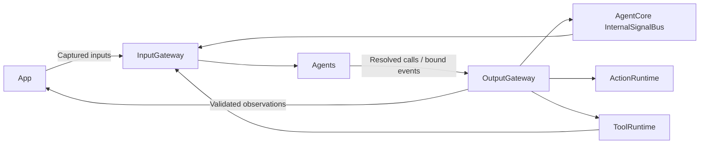

# Gateway — model-independent input and output boundaries

Purpose: connect admitted input, Agent communication and resolved execution without owning models or hardware. Design goals: explicit validation, bounded delivery, failure isolation and observable completion.

✅ InputGateway validates AgentInput envelopes and routes static subscriptions or explicit targets. PlatformKit performs device I/O; SpeechPerception and VisionPerception perform model-driven adaptation. No ASR/VAD/image-content processing remains here.

✅ OutputGateway validates ActionCall/ToolCall and dispatches through ActionRuntime/ToolRuntime; ToolResult returns through InputGateway. Typed perception events use bound source ports and InternalSignalBus, separate from Action/Tool model protocols.

✅ The Gateway target depends only on AgentCore, ActionRuntime and ToolRuntime. Automated checks reject ModelKit/PlatformKit/concrete Agent imports and model target dependencies.

✅ Channel scheduling retains per-channel order, shared-module exclusion and explicit overflow; event delivery has independent bounds and latest-state lanes. See Input, Output and AgentCore/Bus READMEs for algorithms and limits.

❌ General request/reply, dynamic subscriptions, model-assisted routing Agents, preemption and robot control remain future work. No separate Signal implementation or unused model router is created.
