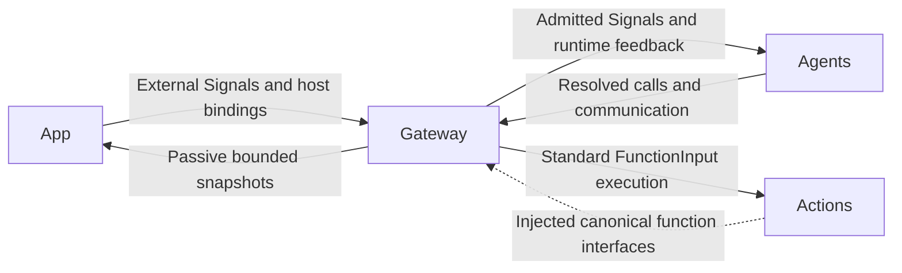
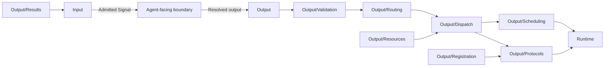

# Gateway — Signal Admission and Authorized Execution

## Summary

Validates Signal transport and resolved output, coordinates execution and returns owner-directed evidence.

## Ownership and boundaries

Gateway owns authority/admission/routing/execution coordination; Agents owns business meaning and alias resolution. Gateway imports AgentCore, FunctionContracts, ExecutionRuntime and CallRuntime; its native input adapters additionally use PlatformKit. It never imports concrete Actions, UI, ModelKit or App. Foundation calls inside an Agent do not pass through Gateway.

## External relationships and data flow

Runtime arrows show data or capability calls; dashed arrows show injection.

## Internal structure

## Public interfaces and protocol policy

InputGateway validates external/Agent/runtime provenance, source/session/schema/deadline and bounds. External production facts use publish with exact static or host-controlled dynamic subscriptions. Explicit host controls may use subscribed send and await admission; arbitrary external targets remain disabled by default. OutputGateway validates the bound actor/incarnation and permissions before calling functions, communicating or scheduling. Source authority cannot come from payloads.

| Protocol | Execution | Feedback |
| --- | --- | --- |
| ActionCall | Task-local Channel/wait scheduling | Declared terminal/failure feedback; every generated call has round evidence |
| ToolCall | Direct shared execution; scheduled native bindings reject | Returning feedback or deterministic completion-only outcome; generated calls retain terminal evidence |
| CommunicationAction send | Directed live-target admission | Correlated receipt, distinct from task result |
| CommunicationAction publish | Bounded one-way fan-out | No subscriber or observer receipt |

Both call protocols use the same canonical FunctionExecutor, budgets, reports and resource authority. Fixed code may use either. A handler failure ends that call and advances eligible work; structural/admission/identity failures have task-scoped cleanup. Completed effects are never replayed on delivery failure.

## Ordering and lifetime

Task-local Channel FIFO and resource ownership are distinct. Wait groups gate only their own task tree; native Tools are outside wait. Resource handoff joins old writers before granting new authority and retains unfinished cleanup after timeout. Device health is independent of occupancy.

Output consumers bind actual Agent instances before reading. Task grants authorize effect execution; terminal runtime controls may finish after grant retirement while still validating real producer/session. Round sealing joins both transports, scheduled execution and scoped feedback before continuation acknowledgment.

## Compilation

Gateway contains Input and Output orchestration. Runtime compiles as ExecutionRuntime (FunctionContracts only); Output/Registration and Protocols compile as CallRuntime (FunctionContracts/ExecutionRuntime). Host assembly supplies catalogs and endpoints; startup coverage validates them separately from effect correctness.

Bound provenance, direct/queued protocol separation, bounded feedback and passive observations are implemented.

## Related design

[Parent design](../README.md) · [Input](Input/README.md) · [Output](Output/README.md) · [Runtime](Runtime/README.md)

## Skill 函数目录

模型函数按执行所有者提供的不可变轮次快照验证，无模型轮次的固定调用按 descriptor 验证；不再用静态白名单拦截已加载 Skill。通信授权、身份、任务范围和生命周期校验继续独立执行。

## Channel-owned Action ordering

Action metadata has no serialization key. [ChannelScheduler](Output/Scheduling/README.md) owns task-local FIFO/wait ordering; ResourceCoordinator rejects unconfigured conflicts without a queue and preserves explicitly configured joined takeover.

## Lifecycle-owned conversation and audio

Gateway 不为 Signal、收件箱或轮次附加隐式 TTL。接纳和执行有界；生命周期由会话、执行 owner、结果屏障及取消决定。实时感知新鲜度由对应契约校验，Action 超时由实际执行者报告。

## Action timeout contract

Action/Tool 共用 FunctionExecutor 的基础默认、静态和 dynamicTimeout 预算。有限组合整体 deadline 与叶子 deadline 同时生效，保留成功项及晚到清理报告。持续活动 timeout 仅约束开始/更新/停止调用，不限制独立 worker 的寿命。

agent.cancelled is a producer-bound terminal cancel control, accepted for retired task scopes and routed to original source/input scheduling identity; it does not record an execution error.

Host reply interruption: OutputGateway.cancelCalls binds actual producer/incarnation/session and preempts a scheduled playback wait without closing other producers or session resources. ChannelScheduler retains cancelled state through the ordered boundary so a late seal reports cancellation. Transport cancellation terminals retire only the original input/round.

OutputExecutionResult 已增加 isCancellationOnly 纯取消分类。原始调用结果、Tool isError 和取消报告仍保留在 executionResults；仅 cancelled 且不含其他执行/投递失败的结果不进入运行异常快照/首页 toast。不能按 CancellationError 文本过滤；读取类型化代码和完整报告，混合失败/超时/投递失败照常记录。OutputGateway 将局部抛出的 CancellationError 归为 cancelled，调用方真实任务取消仍传播并加入清理。

Producer/session cancellation joins scheduled and direct native execution, preserves input fences until terminal transport, and retains cancelled evidence without incidents. Producer shutdown joins direct work. Actual failure/delivery errors remain explicit; see Output for transport ownership.

## 待实现

- Durable transport/results, global fairness scheduling and hardware stop acknowledgment are not implemented.

## 分类异常诊断

✅ Agent 失败诊断随原终止控制进入有界失败快照，保留分类、代码和输入/会话/轮次；Gateway 不重新归因、提供业务文案或发起重试。

## Platform 根、设备接入与同帧呈现

✅ Gateway/Input 拥有 DeviceInputAdapter 和 DeviceInputConnection，单向依赖 PlatformKit；原生输入适配与通用分发分开，Gateway 不依赖具体 Agents、Actions 或 UI。适配器固定 external 来源与无 incarnation 的信封，InputGateway 继续拒绝外部伪造运行结果。业务消息语义仍由所属模块解释。

✅ 输出信封可携带按需保留的通用图像附件；Gateway 校验帧一致性、新鲜度和已绑定生产者后，将只读原生值绑定到单次 Tool 执行。附件不进入 JSON、诊断、历史或 State。

## 视觉停顿恢复修复

✅ consumeSignals 的最新态媒体输出因捕获时间达到 750 ms 或父输入过期而被拒绝时，记录序号和拒绝原因后继续消费；其他权限/结构/执行错误保持失败。

## 视觉过期呈现可观测性

✅ consumeSignals 增加可选 onMediaExpired 回调，在队列前或派发中过期时记录并通知调用拥有者。该通知不重放帧、不改变其他错误传播；视觉拥有者将持续呈现过期纳入健康告警，后续成功呈现恢复。

## 视觉 queueFull 修复

✅ consumeSignals 支持拥有者显式声明 latest 替换键；普通离散 FIFO 溢出仍拒绝，报告具体队列、容量、来源和序号。

## 统一外部输入与动态订阅

✅ ExternalInputAdapter 统一封装业务、文字、设备和扩展传感器输入，不引用具体业务模块。InputGateway 提供宿主订阅，校验注册 schema、目标输入和来源权限。静态/动态关系合并去重，外部与 Agent 广播共享分发；订阅不能获得执行或反馈权限。
