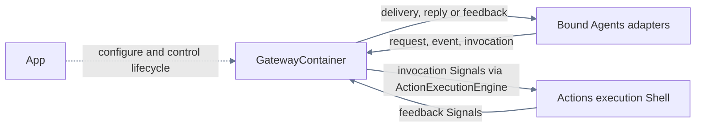
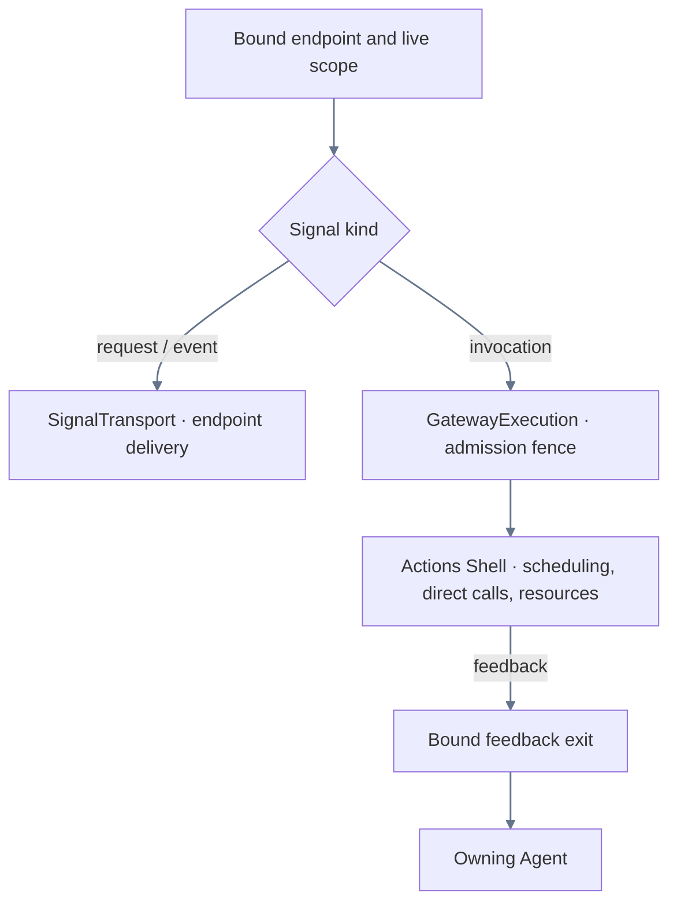

# Gateway — Internal Signal communication

## Ownership and interfaces

GatewayContainer is the unique App-scoped Signal root. App configures, starts, suspends and stops it. Gateway owns endpoint identity, Signal envelopes, capacity and the admission fence for all four internal Signals: Agent–Agent requests and events, Agent→Action invocations and Action→Agent feedback. It imports only FunctionContracts and has no AgentCore, Agents, Actions, CallRuntime or ExecutionRuntime dependency.

Agents owns role instances, communication policy, Skill/Task availability and authorization revocation. Its cognitive InputGateway/OutputGateway adapters live in Agents/Support. Gateway does not retain an AgentManager, inspect roles or recheck Skill permission. ActionsContainer owns the [execution Shell](../Actions/Support/Shell/README.md) behind the neutral `ActionExecutionEngine` contract: Channel scheduling, direct Tool calls, resource arbitration, function resolution, validation, budgets and actual work.

## Direct relationships

The App edge shows lifecycle and configuration. Solid arrows show requests, delivery and returned data. App builds the Shell in ActionsContainer first and hands it to Gateway; Gateway binds the endpoint-identity check and the feedback exit into it exactly once.

## Internal ownership

| Area | Responsibility |
| --- | --- |
| GatewayContainer / GatewayFailure | Configuration, admission, revision-fenced foreground transitions, main facilities and bounded isolated scopes. |
| [Input](Input/README.md) | Agent–Agent Signals: opaque endpoint delivery, typed Request/Reply, explicit-channel events, endpoint tokens/incarnations, envelope checks, bounded sends and joined retirement. |
| GatewayExecution | Agent→Action and Action→Agent edge: gates new invocations, lease requests and calls on Gateway admission and forwards to the Shell. DetachedActionExecution rejects every invocation for isolated observation scopes that have no Actions attached. |

Scheduling, direct calls, resource arbitration and result ledgers are not implemented here. Role routing, coverage and policy validation compile from Agents/Support.

## Signal categories in this module

Gateway carries internal Signals only. Agent–Agent traffic (typed Request/Reply and event pub/sub) uses [Input](Input/README.md); Agent–Action traffic (invocation and result feedback) crosses GatewayExecution into the Actions Shell. External Signals from PlatformKit, UI and ModelKit use their own SignalListener contracts and never enter Gateway.

## Internal flow

## Admission and execution edge

GatewayExecution checks the root admission fence before enqueue, schedule, direct execution and lease acquisition or renewal, then forwards to the Shell. Finish, cancel, release and snapshot calls stay available while draining so cleanup can complete. The Shell validates endpoint identity through the bound `signals.validateExecution` check, which fences stale incarnations. ActionCall, ToolCall, preparation, Channel/wait ordering, resource permits and result retry are specified in the [Shell design](../Actions/Support/Shell/README.md). Gateway never interprets a function, resource or result.

The feedback exit delivers `ExecutionStart` and `ExecutionResult` to the registered Agents adapter. Accepted means receiving admission, retry indicates temporary pressure, and closed indicates a stale or absent scope. The Shell owns ordering, redelivery and its bound. Agents projects Assistant’s Action, round and interruption-scope events through `action.execution.feedback.v1` and authenticates their owner, session and causal identity. See the [ownership matrix](../README.md#action-lifecycle-responsibilities).

## Lifetime and capacity

Construction creates stable inert transport/admission ports. Configuration occurs once and binds the Shell. App starts Actions → Gateway → Agents; stop joins Agents → Gateway → Actions, then unbinds host ports. Gateway closes its admission fence before joining transport work. ActionsContainer owns the Shell lifecycle: it cancels and joins scheduled, direct and resource work on suspension and stop. Gateway stops neither Agents nor Actions itself.

SignalTransport bounds endpoints to 128, active sends to 256 and declared retained payload bytes to 8 MiB, rejecting overflow. Execution bounds and overflow rules are owned by the Shell README. Root observation scope capacity is one; each scope owns independent transport and cleanup, with parent admission/revision fencing. Replacement does not inherit old endpoint tokens or work.

Pause retains identity-bound terminal/draining behavior and joins ordinary transport work before resume. Rapid foreground changes cannot reopen a stale generation. Stop is coalesced and retains cleanup failure. There is no hidden conversation TTL, durable transport, global fairness queue or claim of hardware stop acknowledgment. Evidence limitations are recorded in [validation](../../docs/validation/README.md).

## Reflexive state reads

`GatewayContainer.stateSnapshot() async throws` returns root data and an index for the Signal transport. stateReaders() binds independent readers for the root and `gateway.signals` without opening capabilities, observation scopes or sampling any facility. Nodes describe tracked endpoints/deliveries/bytes and event bindings, publications, branches and observers. Scheduler, direct and resource nodes are published by ActionsContainer as `actions.scheduler`, `actions.direct` and `actions.resources`. Root and child reads remain actor-isolated; collection is not a transaction across facilities.

Gateway State queue depths and endpoint/delivery counts are Runtime. Its engineering health/issues remain separate; no transport counter is a Business attribute.

Agent-provided Action calls use their registration Channel; the Shell schedules these resolved calls and ordered wait events, and model text cannot override routing. Assistant supplies an opaque conversation ordering scope so same-Channel outputs remain FIFO across model rounds. Classification and batch formation remain in Agents.

Signal delivery keeps a bounded reserve for trusted cleanup and fences completion after endpoint replacement. Capacity, cancellation and joining semantics are defined by [Input](Input/README.md).

Signal transport exposes two neutral typed facilities: direct Request/Reply with registered schema/handler and deadline, and explicit-channel event publications with source bindings and independent bounded consumer branches. Gateway owns these tasks, queues and cancellation; Agents owns role enablement, authentication, Task scopes and schema content. See [Input](Input/README.md). Event publication is best-effort live delivery without subscriber acknowledgment or late replay; subscriptions can cover a whole channel or an explicit scope/session. Request/Reply remains the direct addressed path. Event limits are injected at GatewayContainer construction and propagated into isolated observation scopes.
