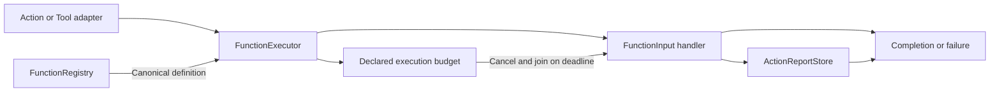

# Protocol-Neutral Function Execution

## Summary

Independent ExecutionRuntime target for canonical registration, budgeted execution, reports and finite composition.

## Ownership and boundaries

Depends only on FunctionContracts. Host/Gateway supplies permissions, scheduling and leases; low-level execution supplies none implicitly. Domain recipes/planning stay in Actions.

## External relationships and data flow

Runtime arrows show data or capability calls; dashed arrows show injection.

## Registry and execution

FunctionRegistry validates at most 256 unique ActionFunctions. FunctionExecutor looks up the canonical definition, validates invocation/completion kind and chooses request-dependent executionBudget before constant timeout or caller/default fallback. Default timeout is 30 seconds; invalid explicit budgets fail, never silently fall back. Queue time is excluded.

Returned terminal reports take precedence over stored children; if a throw has no full terminal report, preserve stored entries and append the original failure. Partial failure cannot become success. ActionReportStore has one report slot and duplicate reporting fails. Producer codes/description remain bounded neutral data.

## Cooperative lifetime and composition

ActionDeadline/CooperativeExecution races deadline/caller cancellation, cancels and joins body cleanup before returning. A non-cooperative handler can outlive its deadline; no forced interruption or false release exists. ActionComposition supplies bounded finite generic steps/results/delays and inherited resource context; business recipes remain outside this target.

✅ One canonical executor, report precedence and cooperative joined deadlines are implemented.

❌ Durable execution, arbitrary rollback and generic physical-stop proof are not implemented.

## Related design

[Parent design](../README.md)
