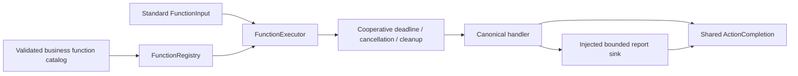

# Shared Execution Runtime

Purpose: register and execute canonical functions independently of call protocols. Design goals: one implementation store, bounded state, joined deadlines/cancellation and an independent ExecutionRuntime target.

✅ FunctionRegistry validates at most256 unique ActionFunctions. FunctionExecutor looks up the canonical function and consumes canonical budget metadata and owns stored/returned report precedence and completion-kind validation. It accepts FunctionInput, not Agent or protocol envelopes. Dynamic budgets override constant timeout and caller fallback; queue time is excluded.

✅ ActionReportStore implements FunctionReporting with one report slot and explicit duplicate-report failure. ActionDeadline/CooperativeExecution cancel and join cleanup; caller cancellation propagates. ActionComposition supplies bounded generic finite composition. Recipes and motion shaping remain business Actions.

✅ This target depends only on FunctionContracts; it has no AgentCore, call-protocol, business, model, UI, App or device dependency. Gateway separately supplies permission/owner checks, queues and resources. Low-level executor calls acquire no lease or authorization.

❌ Durable execution, generic progress, arbitrary rollback and physical stop proof are not implemented.

✅ FunctionExecutor supplies protocol-neutral failure normalization preserving child reports and bounded terminal causes. Gateway call adapters use it at terminal result boundaries; low-level execution still throws for callers that handle errors themselves.
