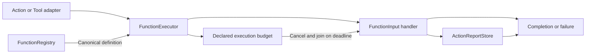

# Protocol-Neutral Function Execution

## Summary

Independent ExecutionRuntime target for canonical registration, budgeted execution, reports and finite composition.

## Ownership and boundaries

Depends only on FunctionContracts. Host/Gateway supplies permissions, scheduling and leases; low-level execution supplies none implicitly. Domain recipes/planning stay in Actions.

## External relationships and data flow

Runtime arrows show data or capability calls; dashed arrows show injection.

## Registry and execution

FunctionRegistry validates at most 256 unique ActionFunctions. FunctionExecutor looks up the canonical definition, validates invocation/completion kind and chooses dynamicTimeout before its declared constant timeout (30 seconds by default in FunctionContracts); invalid explicit budgets fail, never silently fall back. Queue time is excluded.

Returned terminal reports take precedence over stored children; if a throw has no full terminal report, preserve stored entries and append the original failure. Partial failure cannot become success. ActionReportStore has one report slot and duplicate reporting fails. Producer codes/description remain bounded neutral data.

## Cooperative lifetime and composition

ActionDeadline/CooperativeExecution races deadline/caller cancellation, cancels and joins body cleanup before returning. A non-cooperative handler can outlive its deadline; no forced interruption or false release exists. ActionComposition supplies bounded finite generic steps/results/delays and inherited resource context; business recipes remain outside this target.

One canonical executor, report precedence and cooperative joined deadlines are implemented.

## Related design

[Parent design](../README.md)

ActionFunction 基础默认执行超时为 30 秒，dynamicTimeout 优先于静态 timeout；未声明也有默认预算。Speech.Playback 使用显式 300 秒。超时取消并加入清理，保留真实效果，以 ActionResult 返回；工具复用同一函数契约。通信转发不制造 TTL，队列和整个对话不附加默认时限。

## Action timeout contract

FunctionExecutor 始终通过 executionBudget(for:) 执行带超时的 handler。ActionComposition 自动补齐默认叶子预算并执行合成整体 deadline；Node.action(function:invocation:) 读取子函数自己的静态/动态预算和资源，function(...) 工厂绑定组合预算，避免外层默认值截断组合。工厂 composing 接受纯 request→tree 构造器，预算、资源和执行复用相同构造规则，构造器不得产生 effects。组合必须在 effects 前校验整体预算上限。取消仍加入清理，非协作 handler 没有强制中断保证。

函数叶子在 effects 前解析一次预算，复用内部报告/完成校验路径，由组合叶子的 deadline 执行，避免重复计时与动态预算重算。

函数叶子取消时从自身 FunctionReporting 保留已提交报告，再由叶子 deadline 附加 timedOut，不能丢失已完成子结果。

整体 deadline 与显式取消保留组合报告契约；叶子在加入清理时保存真实完成值/报告，取消后从保存值恢复结果，避免嵌套 deadline 丢失清理完成的成功项。

验证时仅整理ActionComposition显式闭包调用格式，合成执行预算/取消/报告语义不变。

## 待实现

- Durable execution, arbitrary rollback and generic physical-stop proof are not implemented.
