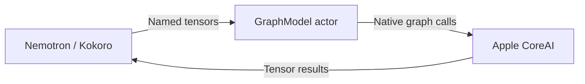

# CoreAI graph backend

Purpose: provide the independent ModelKitCoreAI target for native graph execution and tensor conversion. Design goals: public platform APIs, validated tensor boundaries and no business dependencies.

GraphModel owns AIModel and InferenceFunction. TensorValue copies values and validates names, shapes and scalar types. Adapters own preprocessing and recurrent state. No tokenizer, model registration or voice orchestration belongs here.

- ✅ Native graph execution for Nemotron and Kokoro without a third-party language package.
- ✅ Platform availability checks and tensor conversion.
- ❌ Generic language generation, downloading and cross-model scheduling.

Preserve source attribution in docs/licenses/CoreAIKit-BSD-3-Clause.txt and CoreAIModels-BSD-3-Clause.txt.
