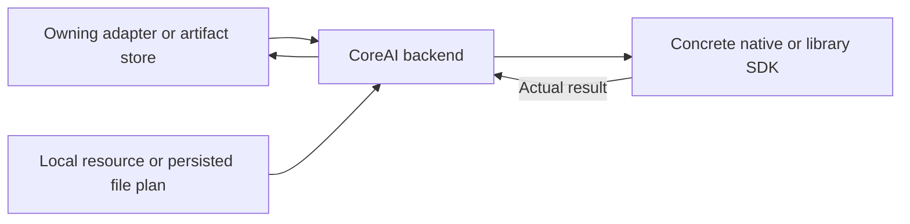

# CoreAI Graph and Gemma Execution

## Summary

Named tensor graph execution and stateful Gemma generation through public CoreAI APIs.

## Ownership and boundaries

GraphModel/TensorValue owns native graph/tensor validation. CoreAILanguageEngine separately owns tokenizer/cache/pipelined language state. Resources are local; registration/download/admission belongs to callers.

## External relationships and data flow

Runtime arrows show data or capability calls; dashed arrows show injection.

## Graph and language contracts

GraphModel actor owns AIModel/InferenceFunction; TensorValue copies values and checks names/shapes/scalar types. Caller owns recurrent preprocessing and a resource lease. Stateful language uses CoreAILM from pinned coreai-models 0.2.8-zoo with static-input buffers; no MLX/downloader/catalog runtime exists here.

Gemma uses checkpoint-matched QAT PLE GPU tables and b2 decoder. iOS h18p AOT supports iPhone18,1/18,2; macOS uses matching uncompiled graph. OS/native/hardware checks and allocation/load failures are explicit. Increased-memory-limit entitlement is required by the large graph allocation.

Each request resets cache, performs single-token prefill and fits prompt/generation within 4096 tokens. Filter private thought channels before text output; decoded text is bounded to 256 KiB. Immediately drain upstream tokens under requested generation count. Cancel/join pipelined worker before resetting/releasing state. No inference queue exists.

✅ Native graph/tensor execution and bounded Gemma backend are implemented.

❌ Other iPhone graph variants and a simulator assembly without the CoreAI dependency are not implemented.

Source notices: [CoreAIKit](../../../../docs/licenses/CoreAIKit-BSD-3-Clause.txt), [CoreAIModels](../../../../docs/licenses/CoreAIModels-BSD-3-Clause.txt).

## Related design

[Parent design](../README.md)
