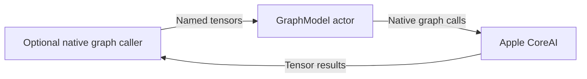
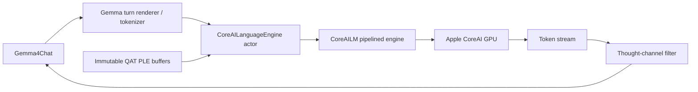

# CoreAI graph backend

Purpose: provide the independent ModelKitCoreAI target for native graph execution and tensor conversion. Design goals: public platform APIs, validated tensor boundaries and no business dependencies.

GraphModel owns AIModel and InferenceFunction. TensorValue copies values and validates names, shapes and scalar types. Adapters own preprocessing and recurrent state. Language tokenizer/graph execution stays in the backend; model registration and voice orchestration belong to their owners.

- ✅ Independent native graph execution and tensor utilities, plus the current Gemma chat backend.
- ✅ Platform availability checks and tensor conversion.
- ❌ Universal model generation, downloading and cross-model scheduling.

Preserve source attribution in docs/licenses/CoreAIKit-BSD-3-Clause.txt and CoreAIModels-BSD-3-Clause.txt.

## Gemma language execution

✅ CoreAILanguageEngine loads the Gemma 4 E2B QAT b2 decode-only graph through CoreAILM from john-rocky/coreai-models 0.2.8-zoo. This concrete integration requires the fork's static-input buffer support; base ModelKit and Management do not depend on it. No CoreAIKit catalog/downloader or MLX runtime is linked.
✅ iOS admits iPhone18,1 / iPhone18,2 only for the h18p AOT artifact; macOS selects the matching uncompiled b2 graph. Checkpoint-matched QAT PLE files are size-validated and loaded once into owned shared GPU buffers. Failed allocation/load propagates. The existing increased-memory-limit entitlement is required for the ~4.47 GB model.
✅ Single-token prefill is explicit. Each request resets cache, uses a 4096-token total context bound, suppresses thought channels, and cancels/joins the pipelined worker before reset/release. No internal request queue; output is bounded by the request token budget and 256 KiB decoded text. The upstream token sequence is drained immediately; its maximum production is the requested token budget. Overflow or decoding mismatch fails visibly.
❌ Broad parity, device memory/thermal acceptance and support for other iPhones remain unverified.

The existing stateless GraphModel remains for tensor callers; language execution owns its stateful engine separately. Downloading remains in Management/ModelKitHub.

❌ The iOS simulator SDK lacks CoreAI; the external CoreAILM target cannot build there. build-ios.sh currently stops on this limitation. Independent UI tests run on Mac; a separate simulator assembly remains outstanding.

✅ 2026-10-04: Mac CoreAI smoke returned “你好”; generation cancellation and unload/reload passed. Four Gemma tests passed. Signed iPhone 17 Pro build and bundled Agent resource verification passed. Full check.sh passed boundaries, format and provisioning checks but failed two unchanged IntegrationTests aim-follow tests (four assertions). build-ios.sh is blocked by the simulator SDK missing CoreAI. Physical model inference remains pending.
