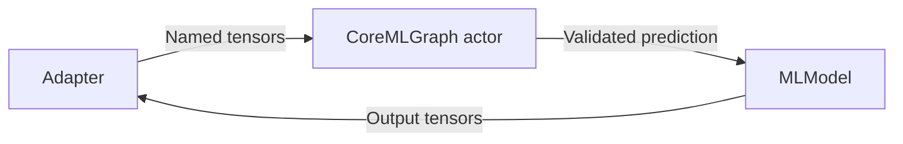
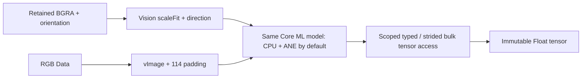

# Core ML backend

Purpose: execute fixed-shape floating-point Core ML graphs in the independent ModelKitCoreML target. Design goals: validated tensor boundaries, serial execution and no business dependencies.

CoreMLGraph owns MLModel and exchanges immutable CoreMLTensor values. Names, shapes and types are checked against model descriptors; Float16 model I/O is supported while the Swift boundary uses Float values. Optional function names and compute settings belong to backend configuration. Silero uses CPU-only execution.

Loading and prediction execute on an actor with no additional task queue. Cancellation is checked around synchronous prediction; an already running native call cannot be forcibly interrupted. ModelResource owns leases and lifecycle; adapters own preprocessing and recurrent state.

- ✅ Fixed-shape float tensors, descriptor validation and serial graph execution.
- ❌ General graph conversion, quantization, downloading and measured device energy guarantees.

## Pose image execution

✅ CoreMLImageGraph accepts local compiled models or compiles local packages; it serializes requests on its actor. The default configuration is cpuAndNeuralEngine, with explicit all available for isolated comparison. This constrains model prediction, not Vision's own preprocessing hardware; it does not guarantee all model operations use ANE.

✅ Native input uses VNCoreMLRequest with scaleFit and VNImageRequestHandler with .up/.right/.down/.left orientation. The read-only source closure is invoked synchronously on the graph actor and must retain its immutable pixel buffer. Vision handles image preparation and returns the raw predictions feature; the adapter decodes the end-to-end rows without NMS. VNCoreMLModel is reused, request state is per call, and cancellation is checked around synchronous native execution.

✅ CoreMLImageLayout distinguishes continuous centered Vision aspect-fit coordinates from rounded integer vImage padding. Vision controls its padding values and resampling; this is not a byte-equivalent replacement for 114-gray letterboxing. Coordinate and human-image acceptance must account for the difference.

✅ RGB/custom input retains CoreMLImagePreparation: one reusable 640×640 BGRA output plus at most one source-sized scratch (max 16 MiB), dimension validation, geometry-change padding reset and direct ROI conversion for already-sized images. The buffer is borrowed only through the synchronous prediction. No extra preparation queue.

✅ PoseTensorReader supports Float16/Float32/Double with actual storage strides and bounds validation. Float32 uses vDSP; no scalar NSNumber indexing. Signposts separate VisionPreprocessAndPrediction, ReadTensor and adapter DecodePose; RGB has PrepareImage and Prediction. Vision preprocessing cannot be split from inference using these enclosing API-level intervals alone; use Instruments for internal attribution.

❌ The current YOLO26 end-to-end head returns [1,300,57], so no external NMS is performed. No device performance guarantee or multi-model Metal pipeline is implemented.

References: [Apple Vision crop/scale](https://developer.apple.com/documentation/vision/vnimagecropandscaleoption), [Core ML compute configuration](https://developer.apple.com/documentation/coreml/mlmodelconfiguration/computeunits), [Ultralytics benchmark](https://github.com/ultralytics/yolo-ios-app/blob/main/docs/performance.md). Its YOLO26 INT8 burst results are not this locally packaged model's camera latency.

✅ YOLO26 contract: exactly one output, discovered by descriptor name, shape [1,300,57]. PoseTensorReader copies contiguous Float32 storage in one block and retains strided/type-aware extraction for other layouts. Old [1,56,8400] output is rejected rather than silently interpreted.
