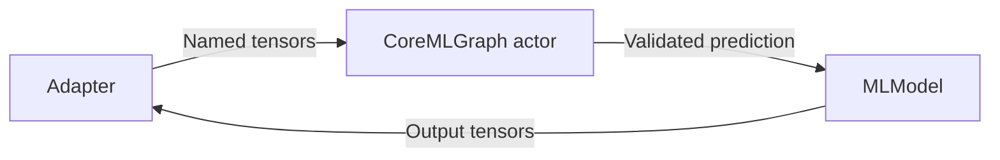

# Core ML backend

Purpose: execute fixed-shape floating-point Core ML graphs in the independent ModelKitCoreML target. Design goals: validated tensor boundaries, serial execution and no business dependencies.

CoreMLGraph owns MLModel and exchanges immutable CoreMLTensor values. Names, shapes and types are checked against model descriptors; Float16 model I/O is supported while the Swift boundary uses Float values. Optional function names and compute settings belong to backend configuration. Silero uses CPU-only execution.

Loading and prediction execute on an actor with no additional task queue. Cancellation is checked around synchronous prediction; an already running native call cannot be forcibly interrupted. ModelResource owns leases and lifecycle; adapters own preprocessing and recurrent state.

- ✅ Fixed-shape float tensors, descriptor validation and serial graph execution.
- ❌ General graph conversion, quantization, downloading and measured device energy guarantees.

✅ CoreMLImageGraph adds actor-owned 640×640 RGB image inference and stride-aware extraction of 1×56×8400 predictions. It accepts local compiled models or compiles local packages to temporary artifacts, uses all compute units, and checks cancellation around native execution. No ModelKit or business dependency is introduced.
