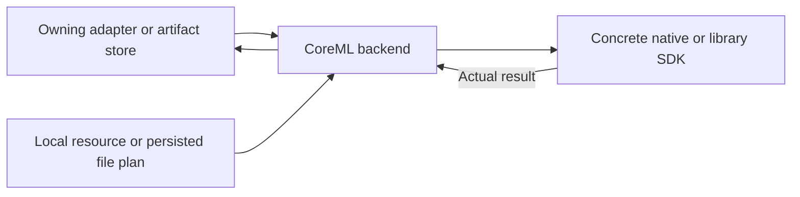

# Core ML Graph and Native Image Execution

## Summary

Serial validated floating-point tensor graphs and reusable native Vision/Core ML pose execution.

## Ownership and boundaries

Actors own MLModel and per-call native state. Adapters own preprocessing/recurrent state/decoding; ModelResource owns lifecycle. No business/model selection or additional request queue exists.

## External relationships and data flow

Runtime arrows show data or capability calls; dashed arrows show injection.

## Tensor and native image interfaces

CoreMLGraph exchanges immutable CoreMLTensor and validates named shapes/types; Float16 model I/O maps to Swift Float boundary. Compute/function selection is explicit; Silero uses CPU-only.

CoreMLImageGraph loads compiled models or compiles local packages, reuses VNCoreMLModel and makes a per-call VNCoreMLRequest with scaleFit and upright quarter-turn orientation. The source closure synchronously returns its retained immutable pixel buffer. Default cpuAndNeuralEngine constrains model configuration, not guaranteed hardware placement or Vision preprocessing device.

YOLO output must have one descriptor-discovered output of shape [1,300,57]. PoseTensorReader uses bulk contiguous Float32 copy or stride/type-aware fallback. Old [1,56,8400] rejects. End-to-end rows are returned without external NMS.

Loading/prediction is actor-serialized; cancellation checks around synchronous native calls and joins them before lease release. A running kernel cannot be forcibly interrupted.

✅ Validated tensor/image execution and reusable native pose graph are implemented.

## Related design

[Parent design](../README.md)
