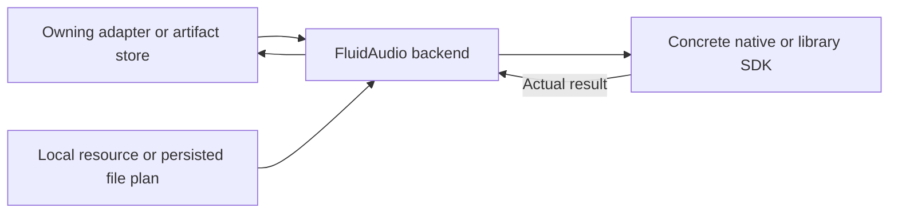

# FluidAudio Speech Graph Backend

## Summary

Shared multilingual Nemotron graph state and optional isolated Kokoro/Mandarin execution.

## Ownership and boundaries

LocalNemotronEngine loads immutable provisioned graphs and creates fresh recurrent sessions. Optional Kokoro has no production registration/download. Caller holds one resource lease; no global speech singleton or waiting queue exists.

## External relationships and data flow

Runtime arrows show data or capability calls; dashed arrows show injection.

## Nemotron and optional frontend

LocalNemotronEngine validates metadata/tokenizer and five compiled preprocessor/encoder/decoder/joint/decoder_joint graphs. The multilingual 2240 ms layout is shared on macOS/iOS; native mel/fused decoder state belongs to each session. No device-specific CoreAI speech export or bundled mel filter is used.

LocalMandarinFrontend bridges published six-input g2pW and already-numbered tone labels, preserving phrase dictionary priority. At most 510 normalized characters/phoneme scalars; ambiguous single characters classify sequentially after dictionary matching. Kokoro stages retain the SDK's 2000 acoustic-frame bound. Contextual inference errors propagate.

Cancellation checks between graph/classifier calls; synchronous Core ML work finishes before lease release. Backend methods never download or supply fallback audio.

✅ Immutable graph sharing, per-session speech state and optional local frontend are implemented.

## Related design

[Parent design](../README.md)
