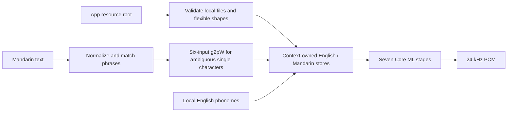

# FluidAudio Core ML backend

Purpose: local Kokoro graph execution and Mandarin preprocessing behind ModelKit. Design goals: immutable provisioned resources, context-owned model state, no runtime downloads or global speech singleton.

✅ Pinned FluidAudio seven-stage Core ML pipeline with the OS 27 padded-input fix. Uses only public lower-level APIs after complete local resource validation. English and Mandarin stores are owned by one resource; NeMo binary trait disabled, Mandarin number normalization remains enabled.

❌ iOS 27 sustained stability is not established upstream; Mac success does not establish device acceptance. Japanese/French/Spanish frontends are not wired in this stage.

✅ LocalMandarinFrontend bridges the published g2pW six-input graph and its already-numbered tone labels; the upstream four-input wrapper is not used. Phrase dictionary matches retain priority; contextual inference errors propagate.

## Ownership and bounds

The caller holds one ModelResource lease for all backend calls; there is no backend waiting queue or global loaded-model cache. Mandarin classification accepts at most 510 normalized characters and processes ambiguous single characters sequentially, after dictionary phrase matching. Each seven-stage call accepts at most 510 phoneme scalars and uses the SDK's 2000 acoustic-frame cap. Cancellation is checked between graph/classifier calls; an active Core ML call must finish before resource release.

