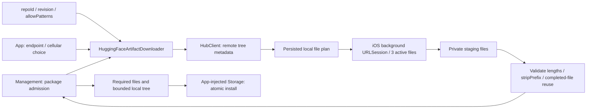

# Hugging Face resource adapter

Purpose: implement Management's `ModelArtifactDownloader` with the official swift-huggingface 0.9.0 client. Design goals: declarative repository selection, configurable endpoint, bounded network concurrency and no duplicate permanent weight cache. The independent ModelKitHub target depends on ModelKitRuntime contracts and the HuggingFace product; Management retains its ModelKit-only dependency.

- ✅ Custom HTTPS host and cellular policy are applied to a per-operation URLSession; no environment credential lookup or global SDK cache.
- ✅ Management admits two active packages and eight pending requests. HubBackgroundTransfer owns at most three active system tasks per package and a persisted plan bounded to 16,384 files, 32 GiB and 8 MiB JSON. Overflow and unsafe/reserved paths fail explicitly.
- ✅ HubClient resolves regular-file metadata; actual transfers use delegate-based background URLSession on iOS and a default session on Mac. isDiscretionary=false requests prompt user-initiated transfers; cellular policy and custom HTTPS endpoints remain supported. Delegate completion moves files and submits the next task synchronously, independent of page/foreground task lifetime.
- ✅ Persisted plans and stable generation-based session identifiers reattach OS tasks after relaunch. Required lengths validate completed files before reuse. Transient network errors retry at most three times per file; system-provided resumeData (at most 8 MiB/file) is persisted and reused. Resume support depends on the server and resume data validity; expired signed links/unsupported resume may restart the affected file. Successfully completed files remain reusable.
- ✅ Failure retains the generation, plan and completed files. Explicit retry reuses them; switching endpoints re-resolves the plan and preserves compatible completed files. Explicit cancel/delete cancels and joins tasks, then discards staging. Successful publication removes download bookkeeping.
- ✅ byte-weighted progress comes directly from delegate callbacks, including reused completed files. Network codes remain observable in Settings; failure offers 继续下载. No SDK/global weight cache is created.
- ✅ App handles OS background events and provides a bounded 25-second preparation window for metadata and final installation. Native transfers continue after suspension. User force-quit cancels system transfers; next launch reattaches/retries using completed files and available resume data. There is no unlimited App execution guarantee or guaranteed bandwidth improvement.
- ❌ Real-phone lock-screen/process-restoration and large-file resume acceptance are pending; size validation is not an independent cryptographic trust anchor.

Storage publishes one installed tree and its local receipt. Deletion removes that tree; this adapter does not retain a separate SDK cache or own model inference/lifecycle.

Validation (2026-10-03): the opt-in production-adapter Silero test passes against both https://huggingface.co and https://hf-mirror.com, verifying intermediate aggregate progress, required files and staging cleanup. Latest iOS device build succeeds. ❌ iPhone UI/network acceptance awaits device reconnection; macOS network tests are not device evidence.

Validation update: native production adapter Silero tests passed on Mac against official HF (11.55 s) and HF-Mirror (9.89 s); these are small-file test durations, not sustained bandwidth measurements. 38 Management and five Hub contract tests, full check.sh, four simulator builds and signed iOS build passed. Installed on iPhone; lock-screen/recovery acceptance remains pending.
