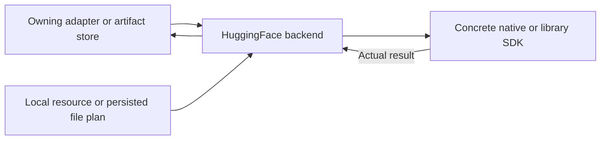

# Hugging Face Artifact Transfer

## Summary

Concrete ModelArtifactDownloader using swift-huggingface 0.9.0 metadata and native persisted background file transfer.

## Ownership and boundaries

ModelKitHub depends on ModelKitRuntime contracts and HuggingFace; Management remains ModelKit-only. App injects endpoint/cellular/background completion. Storage publishes one installed tree; there is no permanent SDK weight cache.

## External relationships and data flow

Runtime arrows show data or capability calls; dashed arrows show injection.

## Planning and transfer

HubClient resolves selected regular files from repository/revision/patterns and optional stripPrefix. Apply custom HTTPS endpoint/cellular per operation, without environment credentials. Persist plan ≤16,384 files/32 GiB/8 MiB JSON. Unsafe/reserved paths and length mismatches fail. Management owns two active/eight pending packages; HubBackgroundTransfer owns three active file tasks per package.

iOS uses stable generation-based background URLSession; macOS uses default session. Delegate completion moves files/submits next work independently of foreground/page tasks. isDiscretionary=false requests timely user-initiated transfers, not an OS guarantee. Relaunch reattaches tasks; completed files are validated before reuse.

Transient file errors retry at most three times. Available system resume data ≤8 MiB/file is persisted; server support/validity determines resume versus affected-file restart. Failure retains plan/generation/completed files; explicit retry/endpoint refresh reuses compatible files. Explicit cancel/delete joins tasks before discarding staging. Successful publication removes bookkeeping.

Progress is actual byte-weighted delegate state including reused files. App supplies background event completion and a 25-second metadata/final-install preparation window. User force-quit may cancel OS transfers; no durable uninterrupted network guarantee is claimed.

✅ Persisted bounded file plans, native transfer reattachment and explicit cleanup are implemented.

## Related design

[Parent design](../README.md)
