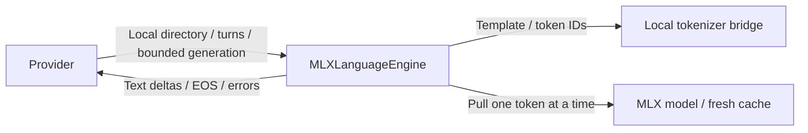
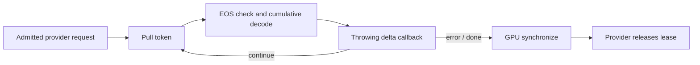

# MLX language runtime

Purpose: load local MLX language models and bridge the existing tokenizer library without exposing backend types to capability consumers.

Design: an actor owns a ModelContainer; each generation constructs fresh recurrent/KV state and pulls at most the requested number of tokens. A synchronous throwing delta callback feeds the capability's bounded stream. Cancellation, overflow and decode errors terminate generation; GPU synchronization completes before lease release. No network download, chat history, Agent registration or device action belongs here.

✅ Pinned MLX Swift LM 3.31.4 and MLX Swift 0.31.4; local tokenizer bridge to existing swift-transformers 1.1.0.
✅ Non-thinking chat template, fresh per-call cache, 128-token prefill chunks, explicit stop IDs, bounded pull loop, Unicode-safe append-only deltas.
✅ Sampling accepts request temperature; top-p 0.8 and top-k 20 are explicit runtime defaults.
❌ Vision input, native tool deltas, grammar-constrained output and cross-model memory scheduling are not implemented.

The Hugging Face Jinja trailing-newline setting is aligned by removing one terminal template newline before rendering. Tokenization must be checked against upstream Python; this does not alter generated text. Memory and throughput require device validation, not inference from weight size.

## Queue and asynchronous processing contract

The provider is the sole caller for an admitted model lease. The engine additionally rejects overlapping generation with `busy`. Inside ModelContainer.perform, a pull iterator computes one token, checks EOS, decodes cumulative text and emits only the newly appended suffix through a synchronous throwing callback. This adds no async output queue: the provider's InferenceSession owns the bounded stream. A failed callback (including overflow) stops the loop. Task cancellation is checked between operations; GPU synchronization runs on every exit before lease release. No queued model requests or forced mid-kernel cancellation are provided.

✅ The algorithm above describes the current implementation.

Maintenance: update this contract when changing producers, consumers, limits, ordering, cancellation or completion semantics.

## Memory during retry

- ✅ Before loading, cap the process-wide MLX reusable allocation cache at 64 MiB (preserving a lower existing cap) and clear unused cached allocations. This leaves more headroom for ASR and model reloads.
- The cache cap does not limit live weights, recurrent/KV state or other frameworks. It is not an overall process-memory guarantee.
- ❌ Sustained iPhone retry/stop/reload acceptance remains required. Memory-pressure reports alone do not establish which process was terminated.

✅ The Defaults assembly explicitly configures the process-wide MLX cache before registering models, using configureCache(limitBytes:). Its budget is 64 MiB. Engine initialization loads only its local model and never changes global allocator policy. Negative limits fail. The cache limit is not a cap on live weights or total process memory.

✅ The Defaults assembly explicitly configures the MLX cache before registering chat; backend initialization never changes the process-wide policy.
