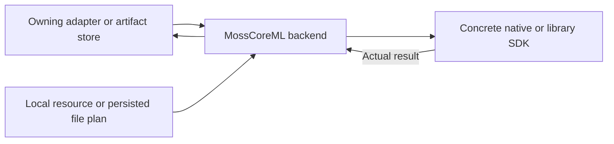

# MOSS Local Graph Pipeline

## Summary

Actor-owned MOSS-TTS-Nano tokenizer/prompt/prefill/step/codec execution using local pinned graphs.

## Ownership and boundaries

LocalMossEngine owns non-Sendable models and synchronous native predictions; capability caller supplies the exclusive resource lease. No downloader/manager/voice encoder, global cache or request queue exists.

## External relationships and data flow

Runtime arrows show data or capability calls; dashed arrows show injection.

## Resources and algorithm

Load four compiled graphs plus config, SentencePiece tokenizer and two preset voice-code files. CPU+GPU is required by Prefill/Step compatibility. Prompt builder/tokenizer/tensor code validates graph shapes, lengths and matching configuration.

Plan at most 32 text chunks. Each chunk has at most 512 prompt rows, 1024-position KV cache and 375 generated frames (30 seconds). Emit decoded 80 ms stereo frames synchronously; inter-chunk silence ≤400 ms. Consumer failure stops generation. Check cancellation before predictions and emission; already-running Core ML work must finish. Frame budget exhaustion without EOS is an error, not truncated success.

Source is adapted from FluidAudio PR 917 commit abbde6b9b80c0e7c2c488f35b0b225c0e8cab08f under [Apache notice](../../../../docs/licenses/FluidAudio-Apache-2.0.txt); attribution remains in source. Capability-level request/PCM limits are documented in the MOSS adapter.

✅ Local graph/tokenizer pipeline and explicit EOS/consumer failure are implemented.

## Related design

[Parent design](../README.md)
