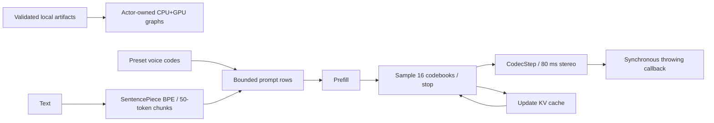

# MOSS Core ML backend

Purpose: local MOSS-TTS-Nano graph execution. Design goals: actor-owned models, no runtime downloads, no hidden queue, no dependency on AgentCore or business modules.

✅ Adapted Apache-2.0 source from FluidInference/FluidAudio PR #917, commit abbde6b9b80c0e7c2c488f35b0b225c0e8cab08f (beta, not merged at integration time). Attribution is retained in each adapted file and docs/licenses/FluidAudio-Apache-2.0.txt. No FluidAudio package update is required; the narrowly adapted implementation is independent of its Kokoro SDK. Local changes remove the downloader, manager, voice encoder and unbounded stream; check cancellation before predictions; treat reaching the frame budget without EOS as an error.

Four pinned compiled graphs plus config, SentencePiece tokenizer and two preset voice-code files are loaded from Models/MossTTSNano. All graphs use CPU+GPU because Prefill/Step cannot compile for ANE. LocalMossEngine owns the non-Sendable graph objects and all synchronous inference on one actor. The capability reserves one operation, so there is no backend queue. It plans at most 32 text chunks, then emits each decoded 80 ms stereo frame synchronously. Consumer failure stops generation. Inter-chunk silence is at most 400 ms. Per chunk there are at most 375 generated frames (30 seconds), 512 prompt rows and a 1024-position KV cache. Total request bounds belong to the capability.

❌ No iPhone stability/performance claim. Upstream text normalization is not ported; numbers/dates need acceptance. Custom cloning, batch codec, ANE execution and runtime downloads are intentionally absent. OS predictions cannot be forcibly preempted. Mac success is not iPhone acceptance.
