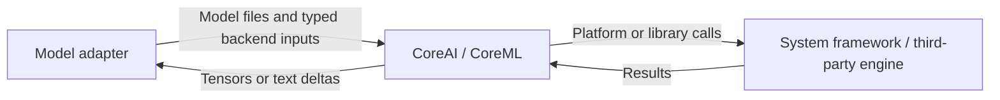

# Inference and resource backends

Purpose: isolate native graph execution, CoreAI language generation and concrete Hub acquisition. Design goals: backend-specific types stay behind adapters; no Agent, Gateway, Action, UI or device orchestration dependency.

| Directory | Responsibility |
| --- | --- |
| HuggingFace | Independent ModelKitHub adapter for declarative artifact acquisition |
| CoreAI | Native graph/tensor utilities and Gemma 4 pipelined language execution |
| CoreML | Validated Core ML graph execution for Silero |
| FluidAudio | Shared multilingual Nemotron Core ML graphs, optional Kokoro and local Mandarin frontend |

- ✅ Separate backend targets compiled from this single source tree.
- ✅ Backend concurrency and cancellation contracts are documented in each child README.
- ❌ A universal backend interchange format or cross-model scheduler.

✅ [MossCoreML](MossCoreML/README.md) contains the pinned, narrowly adapted MOSS beta graph loop and tokenizer. MossCoreML does not implement downloading; ModelKitHub owns the separate resource acquisition adapter. ❌ iPhone stability/performance acceptance remains pending.
