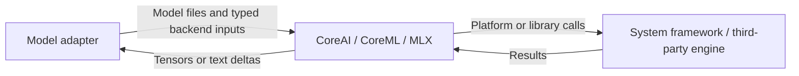

# Inference backends

Purpose: isolate native graph execution and MLX language generation. Design goals: backend-specific types stay behind adapters; no Agent, Gateway, Action, UI or device orchestration dependency.

| Directory | Responsibility |
| --- | --- |
| CoreAI | Native graph and tensor execution for Nemotron |
| CoreML | Validated Core ML graph execution for Silero |
| FluidAudio | Pinned Kokoro Core ML graphs and local Mandarin frontend |
| MLX | Local Qwen generation, tokenizer bridge and explicit allocator configuration |

- ✅ Separate backend targets compiled from this single source tree.
- ✅ Backend concurrency and cancellation contracts are documented in each child README.
- ❌ A universal backend interchange format or cross-model scheduler.
