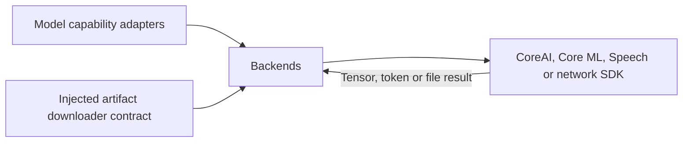
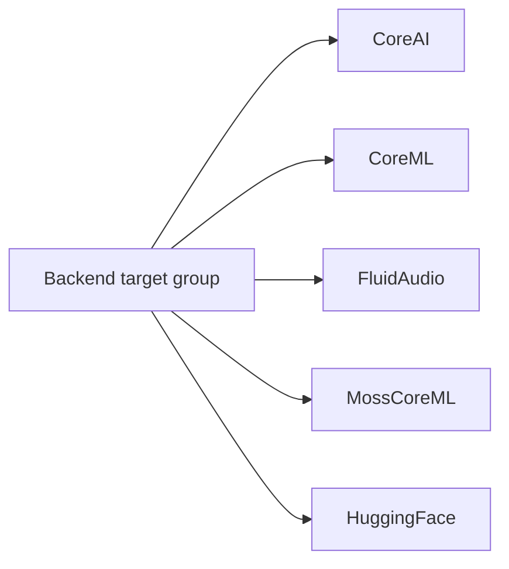

# Concrete Inference and Download Backends

## Summary

Independent native/library targets behind capability adapters and artifact-management interfaces.

## Ownership and boundaries

Backends own native graph/tokenizer/network implementation; adapters own capability request semantics. No Agent, Gateway, Action, UI, Storage or device orchestration dependency is introduced.

## External relationships and data flow

Runtime arrows show data or capability calls; dashed arrows show injection.

## Internal structure

## Target boundaries

CoreAI owns named tensors and Gemma engine; CoreML owns fixed graphs/native pose execution; FluidAudio owns multilingual Nemotron and optional Kokoro/Mandarin execution; MossCoreML owns the local MOSS graph pipeline; HuggingFace is the separate ModelKitHub downloader. Each child documents its own admission/cancellation/format bounds.

✅ Separate backend targets and concrete immutable resource loading are implemented.

❌ Universal engine interchange and cross-model scheduler are not implemented.

## Related design

[Parent design](../README.md) · [CoreAI](CoreAI/README.md) · [CoreML](CoreML/README.md) · [FluidAudio](FluidAudio/README.md) · [HuggingFace](HuggingFace/README.md) · [MossCoreML](MossCoreML/README.md)
