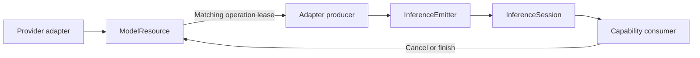

# Inference Data, Sessions and Resource Admission

## Summary

Model-neutral media/request identity, single-consumer streams and adapter-facing managed resource handles.

## Ownership and boundaries

Core owns no capture, files/network, provider selection or business state. ModelContext belongs to Management; adapters acquire/release leases and implement finite cooperative native work.

## External relationships and data flow

Runtime arrows show data or capability calls; dashed arrows show injection.

## Stream admission

StreamLimits defaults to capacity 64/maximumEventBytes 4096. Positive finite capacity×bytes is overflow-checked; nil permits unbounded event count but retains per-event validation. InferenceEmitter.yield rejects a full buffer; it never silently drops. yieldSuspending lets one serialized producer wait for capacity and wakes on consume/cancel/termination; it does not wait when capacity is nil. A second producer capacity waiter fails.

InferenceEvents permits one iterator. Check failure/cancellation before and after awaiting next; terminal error prevents delivery of buffered events. Normal finish drains accepted events. Cancel, consumer cancellation or handle destruction triggers a fast nonblocking adapter termination callback; consumers breaking early must cancel explicitly. Byte estimates are payload accounting, not measured total process memory.

## Managed resource lifetime

A ModelContext owns at most one ModelResource. Coalesce load with 32 waiters and a manager-shared four-loader gate. Reserve one active inference including system speech; busy work rejects with no request queue. Cancelled waiters do not cancel other loads. Lease IDs fence late release/callback registration. OperationAdmission separately rejects overlapping backend operations.

Unload gates new load/acquire and waits for active lease cleanup; completion releases usage, not weights. Shutdown additionally cancels registered active work and is terminal. Atomic memory pressure eviction skips loading/active/closing resources. Maintenance SPI gates retained handles through unload/disk removal; partial barriers release on failure.

## Data and error contracts

AudioFormat/AudioFrame validates model PCM and metadata, separate from PlatformKit/Storage values. ImageFrame accepts tightly packed upright RGB8 or retained read-only BGRA NativeImageBuffer with quarter-turn orientation, at most 4096 per dimension/4,194,304 pixels. The producer must not mutate retained storage. Encoded-image decoding/model tensors remain outside Core.

ModelState is residency (unloaded/loading/ready/unloading/closed or unmanaged), not availability. CapabilityError/Availability provide neutral typed diagnostics; consumers localize and choose recovery.

✅ Explicit session backpressure, media boundaries and matching-ID resource admission are implemented.

❌ Durable event replay, inference waiting queues and forced native interruption are not implemented.

## Related design

[Parent design](../README.md)
