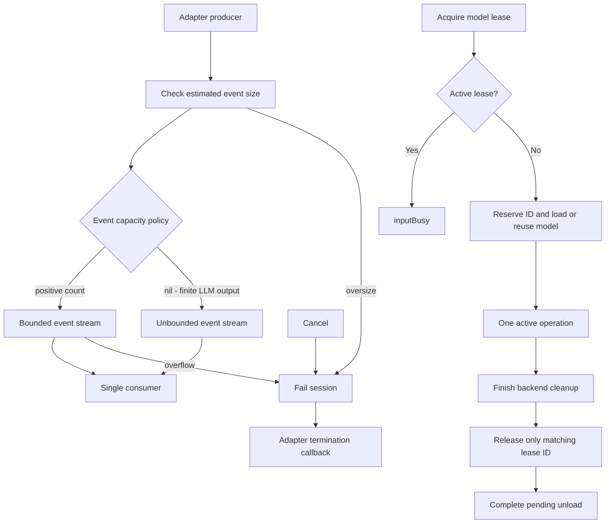

# ModelKit Core — Data, Sessions and Model Admission

Purpose: document the implemented concurrency contracts and their limits. Design goal: explicit ownership, adapter-selected buffering and observable termination.

## Queue and asynchronous processing contract

`InferenceSession` connects one adapter producer to one capability consumer. `StreamLimits.capacity` defaults to 64 and uses `AsyncThrowingStream.bufferingOldest`; an explicit nil selects `.unbounded` for finite LLM replies. Bounded capacity must be positive and its product with maximum estimated bytes/event is checked for integer overflow. The per-event byte limit remains positive for both policies. These are payload accounting limits, not measured total process memory. The producer must serialize emissions.

`yield` checks event size, then stream admission. Oversized events fail with `eventTooLarge`; a dropped yield fails the session with `bufferOverflow`. It never waits for a free slot. The single consumer checks terminal failure before and after awaiting each event, so failure/cancellation prevents buffered events being delivered afterwards. Normal finish permits accepted events to drain. A second iterator is rejected. Explicit cancellation, consumer cancellation or session-handle destruction terminates the session; the adapter's termination callback stops its worker. Callers breaking consumption early must cancel explicitly.

`ModelResource` is an adapter-facing handle owned by a manager-created ModelContext. It coalesces weight loading (32 waiters), reserves exactly one active inference lease per model, including system speech, and rejects busy work without a request queue. One manager shares a four-loader gate across its contexts. Cancellation of a load waiter never cancels other waiters. Explicit unload gates admission and waits for backend cleanup; shutdown also signals registered cancellation callbacks. Neither dropping a completed inference lease nor cancelling one turn unloads weights.

The active lease is one optional record containing its ID and cancellation callback. Release and callback registration require a matching ID; delayed operations from an earlier request cannot alter the current lease.

ModelState reports registered/constructing at the manager, unmanaged for providers without a resource, and unloaded/loading/ready/unloading/closed for managed resources. Residency is not capability availability; query manager.availability(id, for:) separately without loading weights. Lifecycle and composition APIs are in [ModelKitRuntime](../Management/README.md). Adapters load local files through their backend SDK. OperationAdmission independently bounds backend graph operations.
Unsupported: blocking producer admission, durable event replay, request priority/fairness and cross-model resource scheduling.

✅ The algorithm above describes the current implementation.
❌ Waiting admission, replay or additional scheduling guarantees are unsupported unless explicitly stated above.

Maintenance: update this contract when changing producers, consumers, limits, ordering, cancellation or completion semantics.

✅ OperationAdmission admits one backend operation and immediately rejects overlap; it owns no request queue. ModelContext management is restricted to ModelManagement SPI. Memory-pressure eviction is atomic and skips loading, active or closing resources; no cancellation or delayed eviction is introduced.

✅ Core owns capability/session contracts and resource admission. Model registration and lifecycle orchestration are in ../Management; native/library execution is in ../Backends. The root project package compiles these as separate targets.

## Shared media data

Core owns model-independent audio, image and video data contracts. These types describe validated payloads and metadata; they do not capture devices, read files, render UI or own inference engines. Platform adapters convert framework-specific buffers at their boundary.

- ✅ AudioFrame.swift defines AudioFormat and AudioFrame: PCM encoding, sample rate, channels, payload, sequence and timestamp, with size/alignment validation and duration calculation.
- ❌ Image and video contracts will be added here when a concrete capability needs them; no placeholder types are created. Their design must specify representation, dimensions, timing where applicable, payload bounds and ownership.

Keep shared media values separate from model-specific tensors, preprocessing and business message types.

✅ ImageFrame validates tightly packed upright RGB8 data, at most 4,194,304 pixels and 4096 per dimension. ❌ Encoded image decoding, orientation conversion and video transport remain outside Core.

✅ ImageFrame now accepts either RGB Data or a read-only retained BGRA NativeImageBuffer with clockwise quarter-turn orientation. Native storage validates 4 MP / 4096-per-side bounds and format; producer must not mutate it while retained. CoreVideo is an Apple data-buffer API, not a concrete model engine or business dependency. rgb is optional for native inputs; consumers must select the available storage explicitly.

✅ InferenceEmitter.yieldSuspending is an opt-in serialized-producer operation: it suspends at the configured event capacity until the single consumer removes an event. One producer waiter is allowed; synchronous yield retains explicit overflow failure. Cancellation/termination wakes the waiter; cancellation suppresses buffered events. Size validation and single-consumer rules are unchanged. For bounded streams, capacity accounts for emitted events until consumer receipt; no additional task/event queue is introduced. ❌ Concurrent producer emission is unsupported.

✅ Cloud and local LLM adapters explicitly select no event-count cap. Pending fragments drain in order after normal completion; cancellation, errors, per-event size checks and single-consumer ownership still apply. yieldSuspending does not wait for capacity in this mode. Generation/response limits belong to the adapter; this is a user-requested exception to bounded event queues. ❌ This does not remove downstream parser, journal or Action limits or promise bounded total memory for arbitrary unbounded producers.

✅ ADR0098: Audio values are defined once in Types and exported here. ModelKit preserves the original audio constructor labels and CapabilityError validation behavior through forwarding initializers.

## Disk-maintenance admission

✅ ModelContext management SPI exposes beginMaintenance/endMaintenance. ModelResource rejects acquire/load through retained handles while maintenance spans unload and disk removal. Management closes all associated resources before App quiescence, drains/unloads and retains admission barriers until mutation completes; it releases partial reservations on failure. Ordinary unload remains reusable and shutdown terminal. Core owns no file/network/meta handling.

❌ Full iPhone acceptance and non-cooperative backend interruption remain outside this guarantee. See [Management](../Management/README.md#local-model-resources--current-contract).
