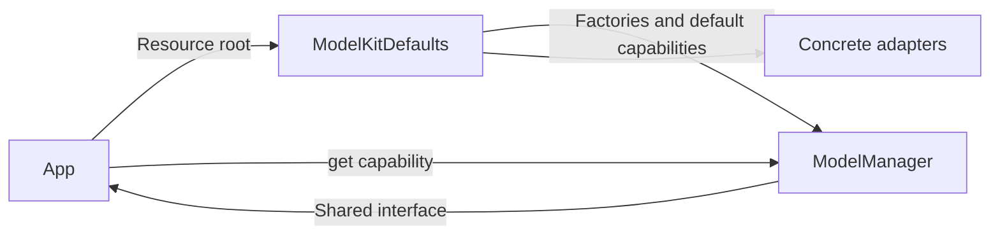
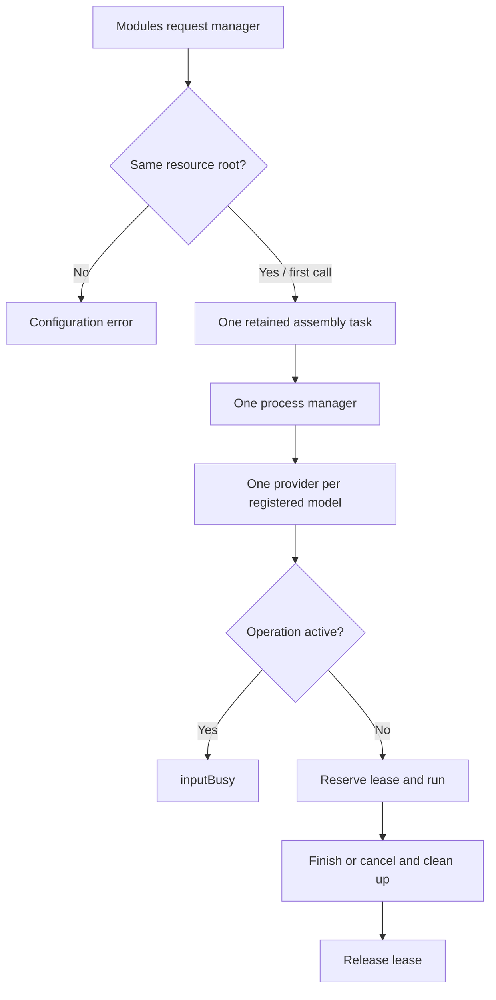

# Default model assembly

Purpose: select and register the project's concrete model providers inside ModelKit. Design goals: one default per capability, deferred weights, explicit platform availability and no business dependency.

| Capability | Default |
| --- | --- |
| Chat | Qwen3.5-2B from Qwen35 |
| Recognition | Nemotron from Nemotron |
| Voice activity | Silero from Silero |
| Synthesis | MOSS-TTS-Nano Core ML beta (Mandarin zh_1 / English en_2) |

MOSS is the synthesis default and is accessible under ModelKitDefaults.mossNano; both return the same managed provider. Kokoro and Apple speech are not registered or used as fallback. Judgment has no provider and fails with missingDefault. Simulator local chat and ASR report unavailable; explicit cloud chat configuration is supported.

ModelKitDefaults.manager(resources:) configures the MLX cache to 64 MiB and registers factories without loading weights. App supplies the Models directory, obtains interfaces through manager.get(.chat), and forwards platform memory warnings. The Defaults target depends on management and adapters; ModelKitRuntime depends only on ModelKit. Models with large local weights opt into idle release on memory pressure.

- ✅ Internal registration and fixed capability mapping; shared MOSS conversation/diagnostic binding.
- ✅ Lazy resource loading, fail-fast registration and teardown on assembly failure.
- ❌ Judgment provider and automatic fallback.

## Process-wide ownership and admission

The first manager(resources:cloudChat:) call fixes the canonical resource root and initial cloud configuration and stores one assembly task before suspension. Concurrent callers join that task (at most 32 waiting callers; overflow throws inputBusy). Equivalent paths share the manager; another root throws resourceDirectoryConflict. Caller cancellation never cancels shared assembly. Assembly failure is retained and propagated; no alternate manager or implicit retry is created. Shutdown is terminal for this process; later access returns the same closed manager.

ModelManager construction and registration are ModelAssembly SPI, reserved for this assembly and isolated tests. Production consumers use this shared entry or injected capabilities. Each model resource admits one operation; overlapping requests fail with inputBusy. Explicit session cancellation requests cleanup, and admission remains occupied until cleanup releases the lease. There is no request waiting queue or automatic preemption. Different model types retain independent admission so VAD and ASR can cooperate during recording.

- ✅ Process-wide manager, bounded concurrent assembly access and terminal shutdown.
- ✅ One operation per model including system speech; cancellation preserves cleanup ordering.
- ❌ Global scheduling across different model types and automatic preemption.

✅ `.pose` binds yolo26n-pose through ModelKitYOLOPose with releaseWhenIdle, loading YOLOPose under the supplied resource root. Registration remains lazy; voice startup does not request pose. ✅ Physical App staging includes pose weights for the independent camera pipeline.

✅ Default .pose now resolves exclusively to ModelID("yolo26n-pose") and the new official end-to-end artifact. Singleton and releaseWhenIdle ownership remain unchanged; no YOLOv8 registration/fallback remains.

✅ `manager(resources:cloudChat:)` optionally selects OpenAI-compatible cloud chat, including on simulator, without loading Qwen or warming the remote service. Omission preserves local defaults. An explicit conflicting initial cloudChat throws `cloudConfigurationConflict`; ordinary manager(resources:) access uses the current configuration. Explicit updates use configureChat and preserve the resource root. App owns Keychain persistence and settings UI.

✅ configureChat(resources:configuration:) explicitly replaces the chat registration in the existing process manager. A nil configuration restores local Qwen. Ordinary manager(resources:) access now obtains the current process binding without resetting it. Explicit initial cloudChat still validates conflicts. App pauses its active voice session and resolves a fresh capability per operation. This supersedes the earlier restart-only limitation. ❌ Network/model availability is not verified by replacement itself.

✅ Startup/diagnostics now perform real in-memory synthesis warmup before conversation admission or measured speech. It exercises lazy kernels using synthetic Chinese text, drains PCM without playback and propagates failures. The first device run took 10.63 s to first PCM without warmup; startup must absorb that compilation cost instead of extending StorageAudio timeouts. ❌ Warmup does not prove sustained runtime stability.
