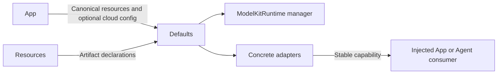

# Default Provider Assembly

## Summary

Process-wide lazy model registration, artifact association and explicit independent speech selection.

## Ownership and boundaries

ModelKitDefaults owns concrete provider mappings and internal assembly SPI. App supplies canonical sandbox roots, catalog/storage/downloader and settings operations. No business flow, Keychain/UI policy or automatic effect retry lives here.

## External relationships and data flow

Runtime arrows show data or capability calls; dashed arrows show injection.

## Provider selection

| Capability | Binding |
| --- | --- |
| Chat | Gemma 4 E2B QAT; explicit cloud configuration replaces chat only |
| Recognition | Enabled installed available Nemotron, else modern Apple |
| Synthesis | Enabled installed available MOSS, else Apple |
| VAD | Installed available Silero, else Energy, independent of ASR preference |
| Pose | yolo26n-pose only |
| Judgment | No default; missingDefault |

Stable speech facades select before an operation; active inference failure does not switch provider. Custom recognition/synthesis default off. Local adapters never auto-download. Kokoro is not registered. Apple recognition combines transcriber/detector; ordinary silence timing uses external Silero/Energy rather than assumed native activity callbacks.

## Singleton and replacement

The first manager call fixes canonical root/initial configuration and stores one assembly task before suspension. At most 32 callers join; different roots or explicit conflicting initial cloud configuration fail. Caller cancellation does not cancel assembly. Failure is retained without an alternate manager; shutdown stays terminal.

configureChat constructs/replaces only the chat binding through existing manager SPI; nil restores Gemma. Other resources/defaults remain. Consumers resolve current binding each request; configured does not mean network reachable/authenticated. configureArtifacts validates matching identities/revisions/directories and injects protocols without importing Storage. JSON defines files, never executable factories.

## Preparation and residency

Registration is lazy. Explicit voice admission/diagnostics prepares selected capabilities and drains real synthetic TTS warmup without playback; initialization does not warm. Failure propagates. Independent per-model leases let ASR/VAD cooperate but reject overlap on the same model.

Large local Gemma/Nemotron/MOSS and pose releaseWhenIdle opt into memory-pressure policy; Silero/system speech retain. Local Gemma requires supported OS/hardware/artifacts; explicit cloud works without Gemma artifacts. Native simulator CoreAI support is a separate backend constraint.

✅ Lazy process assembly, independent speech switches and explicit current-binding replacement are implemented.

❌ Active-inference provider fallback, automatic variant/quantization selection and judgment provider are not implemented.

## Related design

[Parent design](../README.md)
