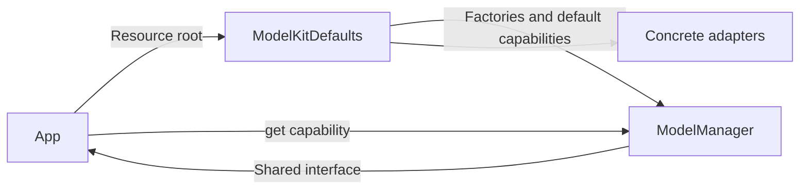
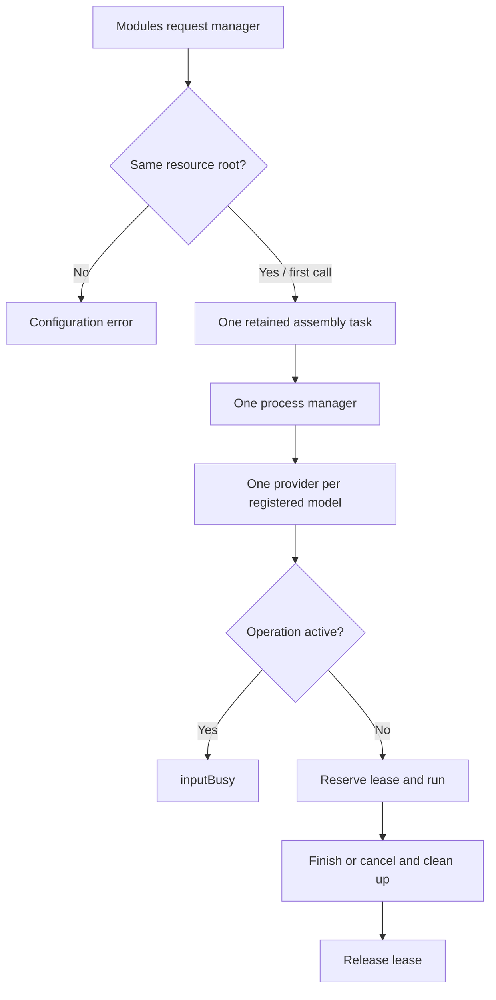

# Default model assembly

Purpose: select and register the project's concrete model providers inside ModelKit. Design goals: one default per capability, deferred weights, explicit platform availability and no business dependency.

| Capability | Default |
| --- | --- |
| Chat | Qwen3.5-2B from Qwen35 |
| Recognition | Nemotron from Nemotron |
| Voice activity | Silero from Silero |
| Synthesis | Apple system voices |

Kokoro is registered under ModelKitDefaults.kokoro for explicit diagnostics; it is not the default synthesizer. Judgment has no provider and fails with missingDefault. Simulator chat and ASR report unavailable without substituting another model.

ModelKitDefaults.manager(resources:) configures the MLX cache to 64 MiB and registers factories without loading weights. App supplies the Models directory, obtains interfaces through manager.get(.chat), and forwards platform memory warnings. The Defaults target depends on management and adapters; ModelKitRuntime depends only on ModelKit. Models with large local weights opt into idle release on memory pressure.

- ✅ Internal registration and fixed capability mapping; explicit Kokoro diagnostics.
- ✅ Lazy resource loading, fail-fast registration and teardown on assembly failure.
- ❌ Judgment provider, automatic fallback and live default replacement.

## Process-wide ownership and admission

The first manager(resources:) call fixes the canonical resource root and stores one assembly task before suspension. Concurrent callers join that task (at most 32 waiting callers; overflow throws inputBusy). Equivalent paths share the manager; another root throws resourceDirectoryConflict. Caller cancellation never cancels shared assembly. Assembly failure is retained and propagated; no alternate manager or implicit retry is created. Shutdown is terminal for this process; later access returns the same closed manager.

ModelManager construction and registration are ModelAssembly SPI, reserved for this assembly and isolated tests. Production consumers use this shared entry or injected capabilities. Each model resource admits one operation; overlapping requests fail with inputBusy. Explicit session cancellation requests cleanup, and admission remains occupied until cleanup releases the lease. There is no request waiting queue or automatic preemption. Different model types retain independent admission so VAD and ASR can cooperate during recording.

- ✅ Process-wide manager, bounded concurrent assembly access and terminal shutdown.
- ✅ One operation per model including system speech; cancellation preserves cleanup ordering.
- ❌ Global scheduling across different model types and automatic preemption.
