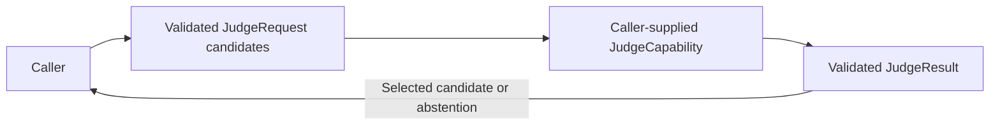

# Candidate Judgment Contract

## Summary

Validated candidate requests, selected-label/optional-score results and explicit abstention.

## Ownership and boundaries

JudgeCapability extends Capability and returns InferenceSession<JudgeResult>. Contracts own validation only; no production provider, routing, Action or calibrated confidence policy exists.

## External relationships and data flow

The diagram shows runtime calls and data flow, not compilation dependencies.

## Request and result validation

Text/candidate array must be nonempty; every candidate is nonempty and unique. Result is selected(label, score?) or abstained. Selected label must be in the exact request candidates; optional score must be finite within 0–1. Score is a provider estimate, not calibrated probability. Request retains InferenceContext; session admission/cancellation belongs to a future supplied provider, not these values.

Candidate/result validation is implemented.

## Related design

[Parent design](../README.md)

## 待实现

- Concrete model provider and calibrated confidence guarantees are not implemented.
