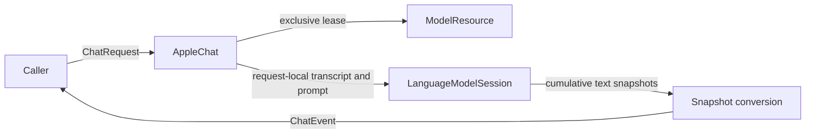

# Apple System Language Model

`AppleChat` implements `ChatCapability` in the standalone `ModelKitAppleLLM` product, using FoundationModels on iOS/macOS 27+. Its only project dependency is ModelKit. No application module, third-party model package, HTTP service or tool executor is involved.

## Interface and data flow

Construct `AppleChat(context:)` with a manager-provided ModelContext and consume it through ChatCapability or ChatModel. It is an optional provider; default model registration remains owned by ModelKitDefaults. Availability reflects SystemLanguageModel.default, including device eligibility, system configuration and model readiness. Apple owns model installation and weights; the resource lease manages application inference admission only.

## Input and output

Leading system messages become ordered instruction segments. Historical user and assistant messages become native prompt/response entries, preserving text and boundaries; the final nonempty user message is the new prompt. System messages after conversation history and assistant-first histories fail explicitly. Each request has a fresh native session, so callers own all history. Context overflow propagates from FoundationModels without hidden pruning or retries.

Tool and image support are false. Tool definitions, forced tool choice, tool history and image input fail before inference. Temperature and optional output token limits map to GenerationOptions. Native errors propagate. Completed sessions emit the system-reported input, cached-input and output token counts. Since the high-level stream exposes no EOS reason, reaching the explicit output token budget conservatively produces `.finished(.lengthLimit)`; otherwise native completion produces `.finished(.stop)`.

Native cumulative snapshots convert to scalar-safe text deltas. Prefix revisions fail because ChatEvent cannot retract output. Output is limited to 256 KiB; each delta contains at most 1024 Unicode scalars. The output queue holds at most 128 events of 4128 estimated bytes each; overflow terminates the request explicitly. Framework-internal buffering is opaque. Dispatch and first-text timing follow the common Chat contract.

## Lifecycle

ModelResource rejects overlapping inference. Each returned InferenceSession owns a cancellable worker via InferenceTaskControl; termination cancels generation and completion joins cleanup. The request-local native session is confined to MainActor, while framework inference is asynchronous. On completion or failure, cleanup waits for the native session to become idle before releasing the lease. No UI page owns work, no application FIFO is added and no fallback provider is selected.

[Chat contract](../README.md) · [ModelKit](../../../README.md)
