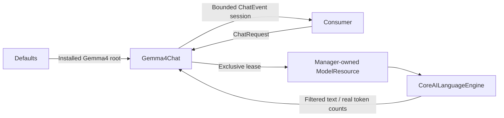

# Gemma 4 E2B chat adapter

Purpose: implement local ChatCapability using Gemma 4 E2B QAT CoreAI. Design goals: capability-only consumers, manager-owned lifetime, explicit failure and private reasoning channels.

✅ ModelKitGemma4 depends only on ModelKit and ModelKitCoreAI. Defaults registers one managed resource and supplies Gemma4 as the installed root. No automatic provider fallback.
✅ Each request resets the backend cache and receives caller-owned history. Admission rejects concurrent requests. Cancellation joins backend cleanup before releasing the lease; unload waits for that lease.
✅ At most 64 nonempty messages / 64 KiB, ending in user, with optional initial system instructions. Prompt plus generation fits 4096 tokens. The output queue holds at most 4096 events of 4096 bytes each; overflow fails explicitly. Usage counts consumed tokens including stop markers. Thought channels never reach Agent text.
✅ iOS uses the pinned h18p AOT graph for iPhone 17 Pro / Pro Max; other hardware fails explicitly. macOS real-model tests require the matching uncompiled b2 decoder alongside the same QAT tables. Cloud settings remain separate.
❌ Mac real inference, cancellation and unload/reload passed using the matching QAT resources. Sustained memory/latency and physical conversation acceptance remain unverified. Native local tools and vision are not implemented.

✅ 2026-10-04: Mac CoreAI smoke returned “你好”; generation cancellation and unload/reload passed. Four Gemma tests passed. Signed iPhone 17 Pro build and bundled Agent resource verification passed. Full check.sh passed boundaries, format and provisioning checks but failed two unchanged IntegrationTests aim-follow tests (four assertions). build-ios.sh is blocked by the simulator SDK missing CoreAI. Physical model inference remains pending.

## Bounded registered-observation continuation

✅ Implemented: Assistant correlates generated Action/Tool calls with runtime-only feedback under the original turn, awaits complete results and requests the next model round. Limits: four total model rounds,16 native calls,64 KiB aggregate feedback/transcript and one30-second joined generation worker. A failed call becomes data for the model, never an automatic function retry. Cancellation clears owned feedback state and joins model cleanup; unknown/stale/duplicate feedback cannot resume a turn. Internal UI receipts and explicit /status retain their existing handling.

✅ Implemented: ModelKit ChatMessage gains provider-neutral assistant tool-call declarations and tool-result messages. OpenAI serializes request-local aliases consistently across declarations and prior calls; Gemma rejects native transcripts explicitly. Storage keeps optional exact text/native continuation JSON and metadata-only image descriptors as data, with bounded records and unchanged v1 compatibility. Camera native model calls use explicit observation registration so actual completion/error can continue reasoning. No change to camera or NexArm function implementation.

## Assistant photo observation — ADR0184

✅ Implemented: Reject image attachments explicitly before tokenization; no pretending local text chat can see images.

❌ Real camera/shutter/animation and configured-model vision acceptance remain pending; video recording and system Photos export are outside this iteration.

✅ Model-interface TTFT: after resource admission/tokenization, sample request start immediately before native generate and the first nonempty generation delta before emission. Loading/tokenization and consumer/UI/storage work are excluded. The optional request sampler does not change native inference or resource cleanup.
