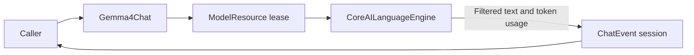

# Gemma 4 E2B Chat Adapter

## Summary

Local text-only ChatCapability using managed Gemma QAT CoreAI resource and caller-owned history.

## Ownership and boundaries

ModelKitGemma4 depends on ModelKit/ModelKitCoreAI. Defaults supplies sandbox Gemma4 and provider registration. Backend owns tokenization/cache/pipelining; adapter owns request/session validation and private-channel suppression.

## External relationships and data flow

Runtime arrows show data or capability calls; dashed arrows show injection.

## Request and output bounds

At most 64 nonempty messages/64 KiB ending in user, with optional initial system instruction. Prompt plus generation fits 4096 tokens. Native Tool declarations/transcripts and image attachments reject before tokenization; no local vision or native-call fallback exists.

Each request resets backend cache. Event stream currently retains 4096 events of ≤4096 estimated bytes; overflow fails explicitly. Usage includes consumed stop tokens. Thought-channel text never reaches public Agent text. The resource owns supported iOS h18p AOT/macOS matching b2 graph selection.

## Admission and timing

One model lease rejects overlap; cancellation joins backend cleanup before release; unload drains the lease. There is no waiting request queue. Sample optional model-interface start immediately before native generate after resource/tokenization, then first nonempty delta before emission. Loading, tokenization, persistence/UI/voice are excluded; missing timing is not fabricated.

✅ Managed local text generation, explicit unsupported inputs and provider timing are implemented.

❌ Local native calls and image inference are not implemented.

## Related design

[Parent design](../README.md)
