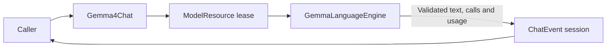
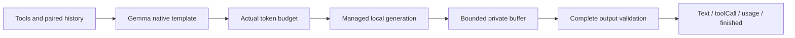

# Gemma 4 E2B Chat Adapter

## Summary

Local text and native-tool ChatCapability using managed Gemma QAT CoreAI resource and caller-owned history.

## Ownership and boundaries

ModelKitGemma4 depends on ModelKit, CoreAILM and Tokenizers. Construction receives ModelContext and a local artifact URL; default registration is owned by Management. This directory owns GemmaLanguageEngine tokenization/cache/pipelining and text filtering; GemmaToolProtocol owns native declarations, argument parsing and result continuation; Gemma4Chat owns request/session validation and the managed lease. Shared worker cancellation comes from Support/Core.

## External relationships and data flow

The diagram shows runtime calls and data flow, not compilation dependencies.

## Request and output bounds

原请求仍限制64条／64 KiB并在裁剪前拒绝图片；无工具请求校验最后一条非system消息必须是非空user，避免丢弃空当前输入后误用历史。推理副本过滤空白历史并完全移除system，允许原请求末尾system事实；错误分别指出边界、当前角色或空输入，不包含消息正文。

The source request accepts up to 64 messages and 64 KiB. The inference copy filters system and empty history messages, keeps up to five recent nonempty dialogue messages including the complete current user input, and drops oldest history to fit actual template tokens plus the generation budget. Images fail validation before tokenization. Tool requests use the complete-history path described below.

Each request resets backend cache. Event stream currently retains 4096 events of ≤2097152 estimated bytes; overflow fails explicitly. Usage includes consumed stop tokens. Thought-channel text never reaches public ChatEvent text. The resource owns supported iOS h18p AOT/macOS matching b2 graph selection.

## Admission and timing

One model lease rejects overlap; cancellation joins backend cleanup before release; unload drains the lease. Provider 直接调用仍拒绝重叠；ModelLanguageContainer 的本地请求由根拥有的 SerialChat FIFO 统一排队。 Sample optional model-interface start immediately before native generate after resource/tokenization, then first nonempty delta before emission. Tool-mode timing records the first validated public output at completion, not raw private generation latency. Loading, tokenization, persistence/UI/voice are excluded; missing timing is not fabricated.

## Related design

[Parent design](../README.md)

## Local Gemma engine

Gemma uses checkpoint-matched QAT PLE GPU tables and b2 decoder. iOS h18p AOT supports iPhone18,1/18,2; macOS uses matching uncompiled graph. OS/native/hardware checks and allocation/load failures are explicit. Increased-memory-limit entitlement is required by the large graph allocation.

Each request resets cache, performs single-token prefill and fits prompt/generation within the backend effective window. Filter private thought channels before text output; decoded text is bounded to 256 KiB. Immediately drain upstream tokens under requested generation count. Cancel/join pipelined worker before resetting/releasing state. No inference queue exists.

[CoreAIModels notice](../../../../../docs/licenses/CoreAIModels-BSD-3-Clause.txt)

## Backend dependency and platform constraints

Stateful generation uses the pinned coreai-models 0.2.8-zoo CoreAILM product and Tokenizers with static-input buffers; generic ModelKitCoreAI is a separate target.

## Consecutive user message boundaries

GemmaLanguageEngine.render emits one prompt turn for each caller message, including consecutive users, without inserted text separators. Assistant still maps to model; each turn is still subject to source validation and the prompt-plus-output token budget.

The effective window is the smaller of the model declaration and the native limit, 1,024 on iOS and 4,096 on macOS. Default fitting reserves min(1,024, window / 4) tokens for output. With no explicit output limit, generation may use the remaining budget. Engine configuration and request validation use the same window.

Native signposts record engine loading, generation, first native token and first visible text. Their metadata carries budgets and counts.

## 直连链路当前契约

显式模拟器构建变体不链接 CoreAI 后端，返回能力不可用；真机和 macOS 固定后端不变。

上下文预算和资源准备完成后，在实际 generate 前调用 ChatRequest.onDispatch；准备阶段失败不报告推理开始。

## Native tool protocol

`GemmaToolProtocol` adapts the existing OpenAI-style ChatRequest.tools/function declarations, assistant.toolCalls and role:tool/toolCallID history to Gemma declaration/call/response markers. Schema types are uppercase; nested objects, arrays, booleans, null, finite JSON numbers and Gemma-delimited Unicode strings retain their values. Result IDs resolve to names within the paired history; results continue the same model turn. Required named tools are instructed in the system prompt and verified on output. No tool execution or cloud fallback occurs in this provider.

Tool requests retain all system messages, declarations and complete call/result history. The real tokenizer counts the rendered protocol before admission; prompts leaving no generation room fail explicitly. There is no five-message truncation in this mode. Default output is at most 1024 tokens and the remaining effective window. Inputs containing reserved special-token syntax in structured tool data or unsupported identifiers fail instead of corrupting the template.

The generation task owns a mutex-protected 256 KiB buffer. The engine stops at the tool-response opener before generating fabricated results. Private reasoning remains filtered. After successful generation, the parser validates the entire output before emitting any calls: names must be declared, arguments must be objects, keys unique, nesting below 64, and calls at most 128. Incomplete markers, malformed values, unexpected content after calls, length-limited calls and required-tool violations fail the session. IDs are newly allocated for validated calls; completion is toolCalls. Arguments remain subject to the caller's tool schema and authorization validation. Cancellation joins the native worker before lease release; failed generations publish no calls. Ordinary no-tool text retains incremental delivery.

Protocol references: [Gemma function calling](https://ai.google.dev/gemma/docs/capabilities/text/function-calling-gemma4), [canonical template](https://huggingface.co/google/gemma-4-E2B-it/blob/main/chat_template.jinja). Protocol support does not expand the native backend window or guarantee model tool-selection accuracy.
