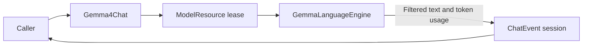

# Gemma 4 E2B Chat Adapter

✅ 已实现（用户指定排查版本）：本地Gemma推理副本完全移除所有system消息（含动态事实），不做前置合并、截短或降级为user；保留最多最近5条非空对话消息和完整当前user，并按后端有效总预算逐条移除最旧历史。删除不再使用的system拟合算法。默认输出预留及实际窗口不变；原始请求、持久历史与云端不变。此排查版本不含system指令，业务行为及真实生成需单独验收。

## Summary

Local text-only ChatCapability using managed Gemma QAT CoreAI resource and caller-owned history.

## Ownership and boundaries

ModelKitGemma4 depends on ModelKit, CoreAILM and Tokenizers. Construction receives ModelContext and a local artifact URL; default registration is owned by Management. This directory owns GemmaLanguageEngine tokenization/cache/pipelining and text filtering; Gemma4Chat owns request/session validation and the managed lease. Shared worker cancellation comes from Support/Core.

## External relationships and data flow

The diagram shows runtime calls and data flow, not compilation dependencies.

## Request and output bounds

✅ 原请求仍限制64条／64 KiB并在裁剪前拒绝图片和原生工具；校验最后一条非system消息必须是非空user，避免丢弃空当前输入后误用历史。推理副本过滤空白历史并完全移除system，允许原请求末尾system事实；错误分别指出边界、当前角色或空输入，不包含消息正文。

At most 64 source messages/64 KiB. System messages are excluded from local inference; at most five latest non-system messages are selected, including current input. Fitting changes only an inference copy, preserving selected message boundaries. Actual full-template tokens plus generation limit fit the backend effective window (at most 4096). Native Tool declarations/transcripts and image attachments reject before tokenization; no local vision or native-call fallback exists.

Each request resets backend cache. Event stream currently retains 4096 events of ≤4096 estimated bytes; overflow fails explicitly. Usage includes consumed stop tokens. Thought-channel text never reaches public ChatEvent text. The resource owns supported iOS h18p AOT/macOS matching b2 graph selection.

## Admission and timing

One model lease rejects overlap; cancellation joins backend cleanup before release; unload drains the lease. There is no waiting request queue. Sample optional model-interface start immediately before native generate after resource/tokenization, then first nonempty delta before emission. Loading, tokenization, persistence/UI/voice are excluded; missing timing is not fabricated.

Managed local text generation, explicit unsupported inputs and provider timing are implemented.

## Related design

[Parent design](../README.md)

## Local Gemma engine

Gemma uses checkpoint-matched QAT PLE GPU tables and b2 decoder. iOS h18p AOT supports iPhone18,1/18,2; macOS uses matching uncompiled graph. OS/native/hardware checks and allocation/load failures are explicit. Increased-memory-limit entitlement is required by the large graph allocation.

Each request resets cache, performs single-token prefill and fits prompt/generation within the backend effective window. Filter private thought channels before text output; decoded text is bounded to 256 KiB. Immediately drain upstream tokens under requested generation count. Cancel/join pipelined worker before resetting/releasing state. No inference queue exists.

[CoreAIModels notice](../../../../../docs/licenses/CoreAIModels-BSD-3-Clause.txt)

## Backend dependency and platform constraints

Stateful generation uses the pinned coreai-models 0.2.8-zoo CoreAILM product and Tokenizers with static-input buffers; generic ModelKitCoreAI is a separate target.

## Consecutive user message boundaries

GemmaLanguageEngine.render emits one prompt turn for each caller message, including consecutive users, without inserted text separators. Assistant still maps to model; original input validation and prompt-plus-output token bounds remain. A weight-free exact rendering regression checks preserved user boundaries; real-model role-order acceptance remains unverified.

## 待实现

- Local native calls and image inference are not implemented.

- The Gemma backend requires a real device or macOS SDK. The explicit simulator build variant removes Gemma from ModelKitDefaults dependencies; the default simulator chat capability reports unavailable without loading a fake model. The standalone backend target is not a simulator implementation. Build and live-model acceptance evidence belongs in docs.

✅ 验证原请求的能力与当前输入后，过滤空历史并移除全部 system，再由 GemmaContextBudget 拟合推理副本；保留当前 user 原文、原有不支持能力的明确拒绝及后端有效总预算。缓存仍逐次重建。

✅ Gemma按后端有效窗口拟合，而非假定4096可用；当前固定CoreAI版本的iOS动态KV安全限制为1024，macOS至多4096，并取模型声明更小值。引擎配置、防御校验及实际token裁剪使用同一限额；默认输出预留为min(1024, 有效窗口/4)，未指定输出上限时最终可使用剩余空间。限制仅属于ModelKit，不修改Agent；不得绕过上游缓存安全保护。

✅ 已实现：用原生signpost记录引擎加载、生成区间、首个原生token和首个可见文字，元信息仅含输入／输出预算和生成数量，不含提示词或输出正文。用于区分冷加载、预填充及隐藏thought等待，不修改通用ChatTiming语义。

## 直连链路当前契约

✅ 显式模拟器构建变体不链接 CoreAI 后端，返回能力不可用；真机和 macOS 固定后端不变。
