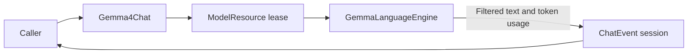

# Gemma 4 E2B Chat Adapter

## Summary

Local text-only ChatCapability using managed Gemma QAT CoreAI resource and caller-owned history.

## Ownership and boundaries

ModelKitGemma4 depends on ModelKit, CoreAILM and Tokenizers. Construction receives ModelContext and a local artifact URL; default registration is owned by Management. This directory owns GemmaLanguageEngine tokenization/cache/pipelining and text filtering; Gemma4Chat owns request/session validation and the managed lease. Shared worker cancellation comes from Support/Core.

## External relationships and data flow

The diagram shows runtime calls and data flow, not compilation dependencies.

## Request and output bounds

At most 64 nonempty messages/64 KiB ending in user, with optional initial system instruction. Prompt plus generation fits 4096 tokens. Native Tool declarations/transcripts and image attachments reject before tokenization; no local vision or native-call fallback exists.

Each request resets backend cache. Event stream currently retains 4096 events of ≤4096 estimated bytes; overflow fails explicitly. Usage includes consumed stop tokens. Thought-channel text never reaches public ChatEvent text. The resource owns supported iOS h18p AOT/macOS matching b2 graph selection.

## Admission and timing

One model lease rejects overlap; cancellation joins backend cleanup before release; unload drains the lease. There is no waiting request queue. Sample optional model-interface start immediately before native generate after resource/tokenization, then first nonempty delta before emission. Loading, tokenization, persistence/UI/voice are excluded; missing timing is not fabricated.

✅ Managed local text generation, explicit unsupported inputs and provider timing are implemented.

❌ Local native calls and image inference are not implemented.

## Related design

[Parent design](../README.md)

## Local Gemma engine

Gemma uses checkpoint-matched QAT PLE GPU tables and b2 decoder. iOS h18p AOT supports iPhone18,1/18,2; macOS uses matching uncompiled graph. OS/native/hardware checks and allocation/load failures are explicit. Increased-memory-limit entitlement is required by the large graph allocation.

Each request resets cache, performs single-token prefill and fits prompt/generation within 4096 tokens. Filter private thought channels before text output; decoded text is bounded to 256 KiB. Immediately drain upstream tokens under requested generation count. Cancel/join pipelined worker before resetting/releasing state. No inference queue exists.

[CoreAIModels notice](../../../../../docs/licenses/CoreAIModels-BSD-3-Clause.txt)

## Backend dependency and platform constraints

Stateful generation uses the pinned coreai-models 0.2.8-zoo CoreAILM product and Tokenizers with static-input buffers; generic ModelKitCoreAI is a separate target. ❌ The third-party CoreAIShared runtime imports CoreAI unconditionally and cannot currently compile against the simulator SDK. ModelKitDefaults' simulator source branch does not eliminate that package dependency. Build and live-model acceptance evidence belongs in docs.

## Consecutive user message boundaries

✅ Implemented: GemmaLanguageEngine.render emits one prompt turn for each caller message, including consecutive users, without inserted text separators. Assistant still maps to model; original input validation and prompt-plus-output token bounds remain. A weight-free exact rendering regression checks preserved user boundaries; real-model role-order acceptance remains unverified.
