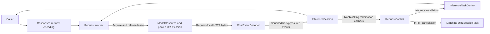

# Responses Cloud Chat Adapter

## Summary

Responses-only streaming ChatCapability with caller-owned history, bounded SSE/native calls and model-residency-owned connections.

## Ownership and boundaries

independent runtime framework adapter depends on ModelKit. Host supplies HTTP/HTTPS endpoint/credentials/model/timeout; credentials stay private/redacted. Registration performs no network generation. Configured availability does not prove authentication/reachability.

## External relationships and data flow

The diagram shows runtime calls and data flow, not compilation dependencies.

## Request encoding

POST baseURL/responses with stream=true/store=false. History travels in input every request without conversation/previous_response_id. System/user text uses input_text, assistant text output_text with annotations=[], user images input_image JPEG/PNG data URLs/detail=auto. Native history uses paired function_call/function_call_output with original call_id. Request-local safe names include paired historical calls; tool declarations and output decoding use only the current request definitions. Definitions flatten the neutral function envelope and send strict=false to preserve caller-defined optional schema fields. The provider does not reinterpret business fields; the consumer validates arguments and execution authority.

Temperature is retained; explicit output budget maps to max_output_tokens, absent stays absent. No protocol fallback, implicit retry or automatic provider switch exists. Providers must implement Responses. store=false preserves caller history control and does not override retention policy. Credentials/model/HTTP/HTTPS endpoint validate; timeout is 1–600 seconds (default 60).

## Streaming and resource cleanup

One ChatNetworkSession resource owns ephemeral URLSession across requests; disable cookies/cache/redirects. A request owns one HTTP task and worker. RequestControl composes Core InferenceTaskControl for worker installation/cancellation/finish and retains separate ownership of HTTP task cancellation. Cancellation signals both without blocking the consumer; the worker releases its lease after request cleanup without destroying the pool; normal terminal completion drains to EOF for reuse. Missing terminal/incomplete EOF fails. Unload/shutdown joins active work, invalidates session and drops wrapper; reload makes a new residency. Shutdown is terminal. One active provider operation rejects inputBusy; no inference queue exists.

Emit text on response.output_text.delta. Validate bounded argument deltas against completed item identity/full arguments; emit no native call before response.completed validates output. Refusal/error/failed/unsupported output/malformed status/usage fail. Native error/response.failed retains only a format-validated ASCII provider code of at most 128 bytes as OpenAIChatError.providerCode; server message and full error body are not retained. Only max_output_tokens incomplete output without incomplete calls maps to lengthLimit. Native-only complete maps to toolCalls, ordinary complete to stop; usage precedes finished. Partial delivered text cannot be retracted or replayed.

## Bounds and timing

At most 64 messages/64 KiB text, 128 declarations/64 KiB declarations, 32,768 requested output tokens, 64 KiB SSE line/event and eight MiB total stream. Native output indices ≤128; item/call IDs ≤512 bytes, safe names ≤64 and string-object arguments ≤4096. Images separately retain four/16 MiB transcript and four MiB each. CR/LF/CRLF, bytewise UTF-8, comments and multiline SSE fields are supported.

The session uses `StreamLimits(capacity: 128, maximumEventBytes: 65568)` and serialized `yieldSuspending` for every event, including the terminal event. A full queue pauses event production without dropping fragments or failing with bufferOverflow. The request retains its operation lease while waiting; normal completion drains accepted events, and cancellation/failure wakes the producer and suppresses buffered delivery. Callers must consume or cancel a session before awaiting ordinary unload, which drains active work without cancellation. Queue limits cover decoded events, not URLSession or decoder memory. ✅ Optional timing starts immediately before URLSession.bytes and samples the first nonempty decoded text or identity-validated function argument delta before consumer delivery. Native-only timing therefore measures streamed model arguments rather than tool execution or terminal validation. Private reasoning and empty deltas do not count; missing samples remain absent. Validation/loading/consumer/voice/UI are excluded.

## Model discovery

Explicit GET /models is separate, optionally authenticated, 30 seconds, no redirects/cache/cookies, one MiB response and 2048 IDs each ≤512 bytes, deduplicated in server order. Empty key omits Authorization; blank endpoint uses configured default. Discovery checks raw IDs only; the consumer owns model eligibility and selection policy. Reconfiguration replaces the chat binding and consumers resolve current provider each request.

Responses encoding, typed streaming, pooled residency and explicit discovery are implemented.

The 128-event queue uses producer backpressure, including terminal delivery; cancellation releases waiting production.

## Related design

[Parent design](../README.md)

## Consecutive user message boundaries

OpenAIChatConfiguration.request emits one Responses message per original user message, preserving original text and attached-image order without inserted text separators. System/assistant/native call/result encoding and existing source count/text/image/pairing limits remain unchanged. Keep the implemented Responses reasoning decoder. Offline and opt-in live regressions verify unmerged consecutive users; acceptance applies only to the tested model.

## Responses reasoning compatibility

ChatEventDecoder accepts bounded reasoning output items and response.reasoning_text.delta/done metadata used by Alibaba Cloud Responses. Validate reasoning identity/summary shape and incremental text fields, then discard this private channel; only output_text contributes ChatEvent.text and first-token timing. Reasoning items in output_item.added/done and terminal output must not be mistaken for unsupported assistant output. Native call indices/pairing, usage/completion, explicit refusal/unknown-output failures and existing stream limits remain unchanged. No protocol switch or provider retry is introduced. Offline fixtures and an explicit live synthetic-context probe verify the behavior; provider documentation: [Alibaba Cloud Responses](https://www.alibabacloud.com/help/en/model-studio/qwen-api-via-openai-responses).

## Non-thinking request policy

OpenAIChatConfiguration.request sends reasoning.effort=none and top-level enable_thinking=false for official dashscope endpoints and workspace *.maas.aliyuncs.com endpoints. OpenAI GPT-5.x/GPT-6 reasoning IDs receive reasoning.effort=none where the policy supports disabling; ordinary GPT-4/older non-reasoning models and unknown provider/model identities retain their original fields. Canonical OpenAI IDs also work through proxies. Known mandatory-thinking o-series, original GPT-5/mini/nano, Codex/Pro variants and GPT-6 Astra/GPT-6.1 Sol reject explicitly at request encoding; no minimal/low fallback, automatic retry, endpoint switch or hidden output-budget increase is introduced. Unrecognized aliases and future capabilities require explicit follow-up validation; provider rejection remains an error. Alibaba parameters never go to OpenAI.

All consumers, including Memory title requests (64 output tokens), pass through this same encoding. Temperature and source message/media/native-call limits remain unchanged for admitted requests. Retain reasoning parsing for explicit failure/compatibility handling; filtering an incoming reasoning channel is not evidence that thinking was disabled. Offline encoding regressions and live synthetic title/chat probes inspect the actual wire flags and returned reasoning-token/event metadata. References: [Alibaba Cloud Responses](https://www.alibabacloud.com/help/en/model-studio/qwen-api-via-openai-responses), [OpenAI reasoning](https://developers.openai.com/api/docs/guides/reasoning), [GPT-5.1](https://developers.openai.com/cookbook/examples/gpt-5/gpt-5-1_prompting_guide).

## 待实现

- Cloud ASR/TTS/video and automatic retry policies are not implemented.

✅ 纯 SSE usage 解码保留 input_tokens_details.cached_tokens/cache_write_tokens，未知字段兼容，非法数值明确失败。不调用真实 API，不改网络或凭据配置。Responses 原有逐条序列化保留多 system 边界；本轮不注入特定模型的显式断点参数。

## 分类异常诊断

✅ ChatEventDecoder 在校验失败点记录明确 reason、stage、event、field、outputIndex、实际及允许的 Tool 名称（最多8项并保留总数）；不改变接纳条件、终态前不发布调用及流清理。OpenAIChatError 通过 ModelKit 中立诊断接口向 Agent 保留原因；旧通用错误仅兼容模型发现等未细分入口。

✅ 配置、模型发现与 Responses 请求同时接纳 HTTP/HTTPS 域名、IPv4 和 IPv6，可带端口及路径；请求保留用户所选 scheme，不自动升级或回退。URL 中用户信息、query/fragment、非法凭据及其它参数仍校验；HTTPS 继续使用系统证书验证。iOS ATS 策略由 [Config](../../../../../Config/README.md) 拥有。

✅ ChatEventDecoder 接纳 response.reasoning_summary_text.delta/done 和 response.reasoning_summary_part.added/done；校验有界 output_index/item_id、整数 summary_index（0..<128）、文本或 summary_text part 结构后过滤，不进入回答、工具调用或首 token 计时。原事件/总流大小、未知事件失败、工具配对及终态/用量校验保持不变。离线覆盖非法索引、结构和截断及 reasoning 后的工具索引；显式 liveOllamaResponsesReasoningCompatibility 用合成输入检验文本、工具调用和结果续轮，不执行设备效果。验证结果见 [Provider 验证](../../../../../docs/validation/Provider-Management.md)。
