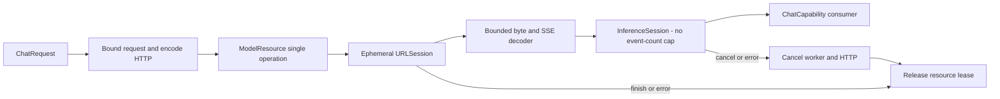

# OpenAI-compatible cloud chat

Purpose: implement third-party cloud text generation behind the same `ChatCapability`, `ChatRequest`, `ChatEvent` and cancellable `InferenceSession` used by local Gemma 4 E2B. Design goals: independent adapter target, no business dependencies, explicit configuration, complete reply buffering and managed lifecycle.

✅ `ModelKitOpenAI` uses Foundation URLSession; no new third-party package. HTTPS Base URL includes the provider's API prefix (for example `https://provider.example/v1`); the adapter appends `chat/completions`. Key, model and timeout are supplied by the host. Uses Bearer authorization when the supplied key is nonempty and Chat Completions `stream`, `messages`, `temperature`, `max_tokens` fields. Providers must support these fields and SSE text deltas.

```swift
import ModelKitDefaults
import ModelKitOpenAI

let cloud = try OpenAIChatConfiguration(
    baseURL: endpoint, apiKey: keyFromSecureStorage, model: selectedModel)
let manager = try await ModelKitDefaults.manager(resources: resources, cloudChat: cloud)
let chat = try await manager.get(.chat)
```

Omit `cloudChat` to retain local Gemma 4 E2B. The resource root remains fixed for the process. Settings changes use `ModelKitDefaults.configureChat(resources:configuration:)` to replace only the chat binding without restarting; existing raw provider handles become terminal, so consumers resolve the current binding for each operation. Defaults owns registration; consumers receive only capabilities. No remote request occurs during registration/load. `availability` means configured, not authenticated or reachable. App settings UI and Keychain credential persistence belong to the host; never put keys in Agent JSON or tracked files.

## Stream and lifecycle design



✅ Requests: at most 64 messages, 64 KiB text and at most 32768 explicitly requested output tokens (omitted by default). No inference waiting queue; overlap fails `inputBusy`. SSE line/event: 64 KiB, cumulative response: 8 MiB. Output: no pending-event count limit; each event retains the 65568 estimated-byte limit. Slow consumers do not cause bufferOverflow; normal finish drains all accepted fragments in order. Exceeding limits fails explicitly, never drops text silently. CR/LF/CRLF, fragmented UTF-8, comments and multiline data fields are supported.

✅ `stop` and `length` map to the shared finish reasons. A finish reason is required; EOF or `[DONE]` before a terminal choice fails. The HTTP request drains trailing usage through `[DONE]` or clean EOF before completing. Refusal and unsupported finish reasons fail explicitly. Errors do not expose provider bodies, URLs or credentials. No automatic retry/fallback; partial text may already have reached the consumer.

✅ One ephemeral session per active request, no cookie/cache persistence, no redirects (including same-host redirects). Timeouts are 1–600 seconds (default 60), including total resource duration. Cancellation, stream failure and manager shutdown cancel the worker; the request is invalidated before releasing admission. Local unload/reload and terminal manager shutdown use the same ModelResource contract.

❌ Cloud ASR/TTS/vision/judge, Responses API, retry and live-provider acceptance. Text-only compatibility is intentional; unsupported modalities are not advertised.

Protocol reference: [official OpenAI Chat API](https://developers.openai.com/api/reference/resources/chat).

✅ OpenAIChatConfiguration.models performs GET /models with optional authentication for explicit user selection: 30-second timeout, no redirects/cache/cookies, 1 MiB response, at most 2048 IDs of at most 512 bytes, deduplicated in server order. Discovery errors are sanitized. App stores nonsecret configuration through Storage and credentials in Keychain and applies it through Defaults.configureChat without restart. ❌ A listed model is not guaranteed to support chat; generation errors remain explicit.

✅ Empty credentials omit Authorization for both discovery and chat. Blank endpoint text resolves to https://api.openai.com/v1; HTTPS validation remains enforced. Discovery excludes known embedding, reranking, moderation, media, legacy completion and specialized non-chat families. Standard /models objects do not expose capabilities, so name-based filtering is heuristic: unknown third-party deployment names remain available. ❌ Discovery does not prove provider compatibility. See [official model objects](https://developers.openai.com/api/reference/resources/models).

✅ Chat output-token budgets are optional and default to nil. Assistant/cloud requests omit max_tokens so the provider chooses its default; local Gemma 4 E2B uses remaining room in its existing 4096-token context. History omits max tokens display and preserves older explicit budgets on disk. The separate 2000-byte whole-reply cap is removed; parser, queue, timeout and per-segment bounds remain. Explicit title/warmup budgets are unchanged. ❌ Live-provider/device acceptance remains separate.

## Native cloud Tool calls

✅ Cloud Chat Completions accepts JSON v6 function declarations and returns complete typed tool calls. ModelKit owns provider-neutral declaration bytes, provider call IDs, names and argument JSON; it imports no AgentCore types. Assistant resolves declared names through ToolCallParser and emits ToolCall through OutputGateway. Internal Tools are never exposed to the model. Local Gemma 4 E2B remains text-only.


Declarations: at most 128, 64 KiB total. Cloud function names use a request-local safe name with an index suffix, mapped back to the declared name before emission; dotted registry paths never become provider identifiers. SSE aggregation admits at most 128 indices, 512-byte provider IDs, 64-byte names and 4096-byte string-object arguments per call, within the existing 8 MiB response bound. Calls are emitted only on tool_calls completion after all pending calls validate. Truncation, unknown names, malformed arguments and cancellation do not dispatch incomplete calls; there is no retry.

✅ Tool-only completion is accepted. Provider IDs remain in ModelKit events; Assistant creates runtime UUIDs for the existing ToolResult correlation contract. Text still uses the existing Action/wait parser. Returning Tools retain the current literal feedback behavior; completion-only Tools produce no result.
❌ Local native tools, result-driven model continuation, partial native tool-call transcripts and Responses API transport.

✅ SSE decoding and request declarations satisfy Swift 6.4 strict formatting; provider behavior is unchanged.

## Usage stream completion

✅ Requests ask for stream_options.include_usage. The adapter continues reading after the terminal choice through trailing usage until [DONE] or clean EOF; it holds the finished event until the stream is drained and the lease released. Only usage may follow a terminal choice. Complete tool calls retain their existing validation/dispatch boundary. prompt_tokens/completion_tokens/total_tokens become provider-neutral ChatEvent.usage; invalid/duplicate usage fails explicitly. Missing usage is allowed and never fabricated.
❌ Real third-party support for include_usage remains an acceptance item; no fallback request or retry is added.
