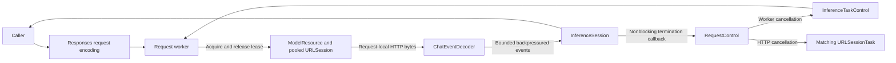

# Responses Cloud Chat Adapter

## Summary

Responses-only streaming ChatCapability with caller-owned history, frame-local SSE parsing and bounded native calls and model-residency-owned connections.

## Ownership and boundaries

independent runtime framework adapter depends on ModelKit. Host supplies HTTP/HTTPS endpoint/credentials/model/timeout; credentials stay private/redacted. Registration performs no network generation. Configured availability does not prove authentication/reachability.

## External relationships and data flow

The diagram shows runtime calls and data flow, not compilation dependencies.

## Request encoding

POST baseURL/responses with stream=true/store=false. History travels in input every request without conversation/previous_response_id. System/user text uses input_text, assistant text output_text with annotations=[], user images input_image JPEG/PNG data URLs/detail=auto. Native history uses paired function_call/function_call_output with original call_id. Request-local safe names include paired historical calls; tool declarations and output decoding use only the current request definitions. Definitions flatten the neutral function envelope and send strict=false to preserve caller-defined optional schema fields. The provider does not reinterpret business fields; the consumer validates arguments and execution authority.

No model-independent output-token ceiling is imposed. Production Agents omit an output budget and use the provider default. Temperature is retained; an explicitly supplied output budget maps to max_output_tokens, absent stays absent. No protocol fallback, implicit retry or automatic provider switch exists. Providers must implement Responses. store=false preserves caller history control and does not override retention policy. Credentials/model/HTTP/HTTPS endpoint validate; idle timeout is 1–600 seconds (default 60); URLRequest and URLSession wait for additional data with that threshold. The resource timeout retains the platform/caller default rather than limiting an entire active response to 60 seconds.

## Streaming and resource cleanup

One ChatNetworkSession resource owns ephemeral URLSession across requests; disable cookies/cache/redirects. A request owns one HTTP task and worker. RequestControl composes Core InferenceTaskControl for worker installation/cancellation/finish and retains separate ownership of HTTP task cancellation. Cancellation signals both without blocking the consumer; the worker releases its lease after request cleanup without destroying the pool; normal terminal completion drains to EOF for reuse. Missing terminal/incomplete EOF fails. Unload/shutdown joins active work, invalidates session and drops wrapper; reload makes a new residency. Shutdown is terminal. 同一客户端支持多个独立推理请求，共用连接资源；每个请求拥有独立租约、HTTP任务、解析器、流和取消控制。无应用请求串行队列，卸载/关闭加入所有活动请求。

Emit text on response.output_text.delta. Validate argument deltas against completed item identity/full arguments; emit no native call before response.completed validates output. Refusal/error/failed/unsupported output/malformed status/usage fail. Native SSE error/response.failed retains a format-validated ASCII provider code as OpenAIChatError.providerCode. HTTP errors read at most16KiB for structured error fields: code/type/param, a validated request ID and a1024-character message with configured credentials, bearer tokens and URLs redacted; raw bodies are never retained. ChatHTTPFailure.swift owns these HTTP/URLError projections. Network failures retain the numeric URLError and timeout/DNS/TLS/offline/connection/cancellation/other classification, with http versus stream stage. They do not retain NSError userInfo, URLs or credential-bearing localized descriptions. Only max_output_tokens incomplete output without incomplete calls maps to lengthLimit. Native-only complete maps to toolCalls, ordinary complete to stop; usage precedes finished. Partial delivered text cannot be retracted or replayed.

## Bounds and timing

Request assembly accepts at most64 messages/64KiB text and native identifiers (opaque argument payloads do not count toward that text budget) and128 declarations/64KiB declarations. SSE parsing retains the current frame without a cumulative response or line/frame generation-size ceiling; completed frames clear their contents and reuse frame-local capacity rather than retaining the stream. Large public text deltas become valid Unicode-scalar32KiB events before entering the unchanged bounded/backpressured queue. Terminal events repeating full output do not impose an artificial generation limit. Native output indices ≤128; item/call IDs ≤512 bytes, safe names ≤64 and string-object arguments have no fixed byte ceiling. Images separately retain four/16 MiB transcript and four MiB each. CR/LF/CRLF, bytewise UTF-8, comments and multiline SSE fields are supported.

The session uses `StreamLimits(capacity: 128, maximumEventBytes: nil)` and serialized `yieldSuspending` for every event, including the terminal event. A full queue pauses event production without dropping fragments or failing with bufferOverflow. The request retains its operation lease while waiting; normal completion drains accepted events, and cancellation/failure wakes the producer and suppresses buffered delivery. Callers must consume or cancel a session before awaiting ordinary unload, which drains active work without cancellation. Queue limits cover decoded events, not URLSession or decoder memory. ✅ Optional timing starts immediately before URLSession.bytes and samples the first nonempty decoded text or identity-validated function argument delta before consumer delivery. Native-only timing therefore measures streamed model arguments rather than tool execution or terminal validation. Private reasoning and empty deltas do not count; missing samples remain absent. Validation/loading/consumer/voice/UI are excluded.

## Model discovery

Explicit GET /models is separate, optionally authenticated, 30 seconds, no redirects/cache/cookies, one MiB response and 2048 IDs each ≤512 bytes, deduplicated in server order. Empty key omits Authorization; blank endpoint uses configured default. Discovery checks raw IDs only; the consumer owns model eligibility and selection policy. Reconfiguration replaces the chat binding and consumers resolve current provider each request.

Responses encoding, typed streaming, pooled residency and explicit discovery are implemented.

The 128-event queue uses producer backpressure, including terminal delivery; cancellation releases waiting production.

## Related design

[Parent design](../README.md)

## Consecutive user message boundaries

OpenAIChatConfiguration.request emits one Responses message per original user message, preserving original text and attached-image order without inserted text separators. System/assistant/native call/result encoding and existing source count/text/image/pairing limits remain unchanged. Keep the implemented Responses reasoning decoder. Offline and opt-in live regressions verify unmerged consecutive users; acceptance applies only to the tested model.

## Responses reasoning compatibility

ChatEventDecoder accepts bounded reasoning output items and response.reasoning_text.delta/done metadata used by Alibaba Cloud Responses. Validate reasoning identity/summary shape and incremental text fields, then discard this private channel; only output_text contributes ChatEvent.text and first-token timing. Reasoning items in output_item.added/done and terminal output must not be mistaken for unsupported assistant output. Native call indices/pairing, usage/completion, explicit refusal/unknown-output failures and existing stream limits remain unchanged. No protocol switch or provider retry is introduced. Offline fixtures and an explicit live synthetic-context probe verify the behavior; provider documentation: [Alibaba Cloud Responses](https://www.alibabacloud.com/help/en/model-studio/qwen-api-via-openai-responses).

## Thinking request policy

OpenAIChatConfiguration owns role-neutral Thinking.minimum/enabled. Minimum disables supported models; original GPT-5 uses minimal, mandatory-thinking o/Codex/GPT-6 Astra/GPT-6.1 Sol use low, Pro variants use their supported medium/high floor. Enabled uses medium (high for high-only variants). Non-none reasoning omits temperature. Ordinary non-reasoning models and unknown aliases receive no invented reasoning parameters; service rejections remain explicit with no retry or model switch. Official DashScope/MAAS receives enable_thinking=false/true, with reasoning.effort=none only in minimum mode. ModelKit does not choose Agent policy.

The caller selects minimum/enabled; this adapter applies the Provider-specific policy without Agent identity. Reasoning streams remain private parsed metadata, never public speech/source content. References: [OpenAI reasoning](https://developers.openai.com/api/docs/guides/reasoning), [OpenAI deployment compatibility](https://developers.openai.com/api/docs/guides/deployment-checklist), [Alibaba thinking](https://www.alibabacloud.com/help/en/model-studio/deep-thinking.md).

The adapter never retries model generation itself. Writer owns classified bounded recovery above ChatCapability. Native arguments have no fixed byte ceiling; malformed argument shape, identity mismatch and call/result ordering still produce structured protocol diagnostics. Discovery-list bounds remain independent of generation.

## HTTP 采集

ChatRequest.transportCapture 是 ModelKit 定义的可选中立回调。OpenAI adapter 在发送前提供实际 method/URL/headers/body，接收 status/headers 后按最多 64 KiB 块提供响应应用层字节，包含 SSE 和非成功状态正文。回调逐块 await，形成背压；EOF 标完成，提前停止标 partial。采集不改变真实模型结果，业务层自行处理存储错误。

凭据型 headers 和 URL 参数脱敏；URLSession 可见传输解码后的字节不宣称为 TLS 抓包。ModelKit 不导入 Storage、也不拥有日志表或 Agent 身份。

ChatToolChoice.required 按请求工具名称映射写入 Responses tool_choice，parallel_tool_calls=false。它不改变配置选择或执行工具；Assistant Decision 验证恰好一次合法分类返回。

onDispatch 在配置校验、资源接纳和取消检查之后、HTTP 发送之前调用一次；传输证据随后进入 transportCapture。准备失败不报告开始，网络/HTTP 错误保留已经发起的事实。
