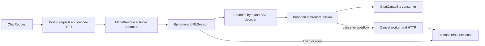

# OpenAI-compatible cloud chat

Purpose: implement third-party cloud text generation behind the same `ChatCapability`, `ChatRequest`, `ChatEvent` and cancellable `InferenceSession` used by local Qwen. Design goals: independent adapter target, no business dependencies, explicit configuration, bounded streaming and managed lifecycle.

✅ `ModelKitOpenAI` uses Foundation URLSession; no new third-party package. HTTPS Base URL includes the provider's API prefix (for example `https://provider.example/v1`); the adapter appends `chat/completions`. Key, model and timeout are supplied by the host. Uses Bearer authorization and Chat Completions `stream`, `messages`, `temperature`, `max_tokens` fields. Providers must support these fields and SSE text deltas.

```swift
import ModelKitDefaults
import ModelKitOpenAI

let cloud = try OpenAIChatConfiguration(
    baseURL: endpoint, apiKey: keyFromSecureStorage, model: selectedModel)
let manager = try await ModelKitDefaults.manager(resources: resources, cloudChat: cloud)
let chat = try await manager.get(.chat)
```

Omit `cloudChat` to retain local Qwen. The resource root remains fixed for the process. Settings changes use `ModelKitDefaults.configureChat(resources:configuration:)` to replace only the chat binding without restarting; existing raw provider handles become terminal, so consumers resolve the current binding for each operation. Defaults owns registration; consumers receive only capabilities. No remote request occurs during registration/load. `availability` means configured, not authenticated or reachable. App settings UI and Keychain credential persistence belong to the host; never put keys in Agent JSON or tracked files.

## Stream and lifecycle design



✅ Requests: at most 64 messages, 64 KiB text and 32768 requested output tokens. No inference waiting queue; overlap fails `inputBusy`. SSE line/event: 64 KiB, cumulative response: 8 MiB. Output: 128 events × 65568 estimated bytes. Exceeding limits fails explicitly, never drops text silently. CR/LF/CRLF, fragmented UTF-8, comments and multiline data fields are supported.

✅ `stop` and `length` map to the shared finish reasons. A finish reason is required; premature EOF or `[DONE]` fails. The HTTP request ends on the terminal choice; trailing usage is not exposed. Unsupported native tools, refusal and finish reasons fail explicitly. Errors do not expose provider bodies, URLs or credentials. No automatic retry/fallback; partial text may already have reached the consumer.

✅ One ephemeral session per active request, no cookie/cache persistence, no redirects (including same-host redirects). Timeouts are 1–600 seconds (default 60), including total resource duration. Cancellation, overflow and manager shutdown cancel the worker; the request is invalidated before releasing admission. Local unload/reload and terminal manager shutdown use the same ModelResource contract.

❌ Cloud ASR/TTS/vision/judge, native tools, Responses API, retry and live-provider acceptance. Text-only compatibility is intentional; unsupported modalities are not advertised.

Protocol reference: [official OpenAI Chat API](https://developers.openai.com/api/reference/resources/chat).

✅ OpenAIChatConfiguration.models performs authenticated GET /models for explicit user selection: 30-second timeout, no redirects/cache/cookies, 1 MiB response, at most 2048 IDs of at most 512 bytes, deduplicated in server order. Discovery errors are sanitized. App now stores selected configuration in Keychain and applies it through Defaults.configureChat without restart. ❌ A listed model is not guaranteed to support chat; generation errors remain explicit.
