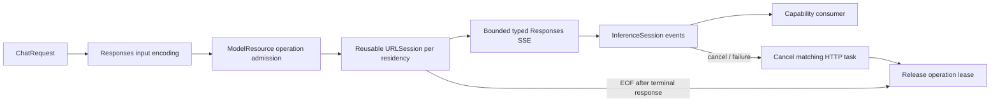

# OpenAI Responses cloud chat

Purpose: implement cloud generation behind the provider-neutral `ChatCapability`, `ChatRequest`, `ChatEvent` and cancellable `InferenceSession`. Design goals: independent Foundation-only adapter, explicit configuration, bounded streaming, reusable connections and model-resource-owned cleanup.

## Request protocol

✅ Implemented: `OpenAIChatConfiguration.request` uses POST `<baseURL>/responses`, stream=true and store=false. Base URL includes the HTTPS API prefix, e.g. https://api.openai.com/v1. The host supplies credentials, model and timeout; credentials stay private and descriptions/errors redact them. No chat request occurs during registration. Availability means configured, not reachable or authenticated.

Caller-owned history is sent through `input` on every decision, without server conversation IDs or previous_response_id. ✅ Prior assistant text uses output_text with annotations=[]; system/user text uses input_text and optional input_image (JPEG/PNG data URLs, detail=auto). Encoding assistant history as input_text is rejected by the official API with HTTP400; native histories use paired function_call/function_call_output items and original call_id. Declarations are converted from the shared legacy function envelope to flattened Responses function objects with request-local safe names. Registered native calls remain available to other consumers; Assistant supplies no Tools and uses text Action tags. No chat/completions fallback or automatic retries exist. Configured providers must support Responses.

Temperature is retained. An explicit output budget maps to max_output_tokens; omitted budgets remain omitted. No reasoning parameters are sent for GPT-4.1, which is a non-reasoning model. Store=false keeps Agent-owned context authoritative; it is not a claim of latency improvement or of overriding provider retention policy.

## Stream and resource lifecycle

✅ Implemented: One ChatNetworkSession resource owns one ephemeral URLSession across successive requests. Cookies/cache and redirects are disabled. Per-request cancellation/failure cancels its HTTP task and worker, preserving the pooled session. Normal completion drains to EOF after the terminal event for connection reuse; an incomplete stream fails. Resource unload/shutdown drops the wrapper after joined request cleanup and invalidates the session; reload creates a fresh residency. Shutdown is terminal. One active operation per provider; overlap fails inputBusy and no inference waiting queue is added. Timeouts remain 1–600 seconds (default60).

Text is emitted on response.output_text.delta. Function argument deltas are bounded and checked against completed item identity/arguments; no function call is emitted before response.completed validates the full output set. Refusals, response.failed, error events, unsupported output types and malformed status/usage fail explicitly. response.incomplete maps only max_output_tokens with no incomplete calls to lengthLimit. Completed native-only output maps to toolCalls; ordinary completion maps to stop. Usage input_tokens/output_tokens/total_tokens accompanies the terminal response, before the consumer's finished event. Partial delivered text cannot be retracted and errors never replay Actions.

Limits: at most64 messages and64KiB transcript text,128 declarations/64KiB total declarations,32768 explicitly requested output tokens,64KiB per SSE line/event,8MiB cumulative stream,128 native output indices,512-byte item/call IDs,64-byte declared names and4096-byte string-object arguments. CR/LF/CRLF, bytewise UTF-8, comments and multiline data fields are supported. No pending-event count limit; each emitted event is bounded at65568 estimated bytes. Image limits are separately four images/16MiB transcript and4MiB per attachment. Slow consumers retain every accepted fragment in order.

First-text timing starts immediately before URLSession.bytes and samples the first nonempty decoded delta before yielding. It includes network and remote-service latency; validation/admission, consumer/persistence, ASR, TTS and UI are excluded. Native-only replies have no text TTFT.

## Configuration and discovery

The host assembles through ModelKitDefaults. Reconfiguration replaces only the chat binding; old handles become terminal and consumers resolve the current binding each operation. Local Gemma remains selected without cloud configuration. No SDK dependency on Agents, UI, Storage or device orchestration is introduced.

`models` remains a distinct explicit GET /models query: optional Bearer authentication,30-second timeout, no redirects/cache/cookies,1MiB response,2048 IDs each at most512 bytes, deduplicated in server order. Empty credentials omit Authorization; blank endpoint resolves to https://api.openai.com/v1. Discovery validates raw IDs, not business eligibility or Responses support. The host owns secure credential references and setting transactions.

✅ A user-authorized temporary credential reproduced the assistant-history input_text HTTP400 on official GPT-4.1; the corrected output_text history returned HTTP200, streamed text and response.completed. A standalone live probe linked the actual compiled ModelKit/OpenAI/Runtime code and verified the same four-message history through URLSession, text decoding, usage and terminal completion (interface TTFT approximately2.11s in one sample). The protocol and adapter probes do not establish full native Agent/UI or physical-device acceptance. Credentials were kept out of repository files and outputs.

❌ General live-provider compatibility, measured physical networking/latency, cloud ASR/TTS/video, local native calls and retry policies remain separate acceptance/work. No real credentials are used in offline tests.

References: [Responses migration](https://developers.openai.com/api/docs/guides/migrate-to-responses), [streaming events](https://developers.openai.com/api/reference/resources/responses/streaming-events), [GPT-4.1](https://developers.openai.com/api/docs/models/gpt-4.1).
