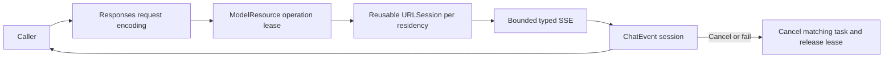

# Responses Cloud Chat Adapter

## Summary

Responses-only streaming ChatCapability with caller-owned history, bounded SSE/native calls and model-residency-owned connections.

## Ownership and boundaries

Foundation-only adapter depends on ModelKit. Host supplies HTTPS endpoint/credentials/model/timeout; credentials stay private/redacted. Registration performs no network generation. Configured availability does not prove authentication/reachability.

## External relationships and data flow

Runtime arrows show data or capability calls; dashed arrows show injection.

## Request encoding

POST baseURL/responses with stream=true/store=false. History travels in input every request without conversation/previous_response_id. System/user text uses input_text, assistant text output_text with annotations=[], user images input_image JPEG/PNG data URLs/detail=auto. Native history uses paired function_call/function_call_output with original call_id; definitions flatten the neutral function envelope and use safe request-local names consistently.

Temperature is retained; explicit output budget maps to max_output_tokens, absent stays absent. No protocol fallback, implicit retry or automatic provider switch exists. Providers must implement Responses. store=false preserves caller history control and does not override retention policy. Credentials/model/HTTPS endpoint validate; timeout is 1–600 seconds (default 60).

## Streaming and resource cleanup

One ChatNetworkSession resource owns ephemeral URLSession across requests; disable cookies/cache/redirects. A request owns one HTTP task and worker. Cancel/failure joins that request without destroying the pool; normal terminal completion drains to EOF for reuse. Missing terminal/incomplete EOF fails. Unload/shutdown joins active work, invalidates session and drops wrapper; reload makes a new residency. Shutdown is terminal. One active provider operation rejects inputBusy; no inference queue exists.

Emit text on response.output_text.delta. Validate bounded argument deltas against completed item identity/full arguments; emit no native call before response.completed validates output. Refusal/error/failed/unsupported output/malformed status/usage fail. Only max_output_tokens incomplete output without incomplete calls maps to lengthLimit. Native-only complete maps to toolCalls, ordinary complete to stop; usage precedes finished. Partial delivered text cannot be retracted or replayed.

## Bounds and timing

At most 64 messages/64 KiB text, 128 declarations/64 KiB declarations, 32,768 requested output tokens, 64 KiB SSE line/event and eight MiB total stream. Native output indices ≤128; item/call IDs ≤512 bytes, safe names ≤64 and string-object arguments ≤4096. Images separately retain four/16 MiB transcript and four MiB each. CR/LF/CRLF, bytewise UTF-8, comments and multiline SSE fields are supported.

The session uses `StreamLimits(capacity: 128, maximumEventBytes: 65568)` and serialized `yieldSuspending` for every event, including the terminal event. A full queue pauses event production without dropping fragments or failing with bufferOverflow. The request retains its operation lease while waiting; normal completion drains accepted events, and cancellation/failure wakes the producer and suppresses buffered delivery. Callers must consume or cancel a session before awaiting ordinary unload, which drains active work without cancellation. Queue limits cover decoded events, not URLSession or decoder memory. Optional timing starts immediately before URLSession.bytes and first nonempty decoded text before yield; validation/loading/consumer/voice/UI are excluded. Native-only has no TTFT.

## Model discovery

Explicit GET /models is separate, optionally authenticated, 30 seconds, no redirects/cache/cookies, one MiB response and 2048 IDs each ≤512 bytes, deduplicated in server order. Empty key omits Authorization; blank endpoint uses configured default. Discovery checks raw IDs only; Actions owns business eligibility. Reconfiguration replaces the chat binding and consumers resolve current provider each request.

✅ Responses encoding, typed streaming, pooled residency and explicit discovery are implemented.

✅ The 128-event queue uses producer backpressure, including terminal delivery; cancellation releases waiting production.

❌ Cloud ASR/TTS/video and automatic retry policies are not implemented.

## Related design

[Parent design](../README.md)
