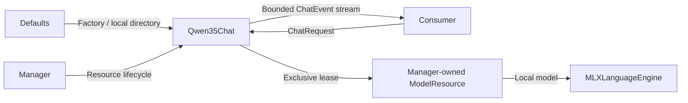
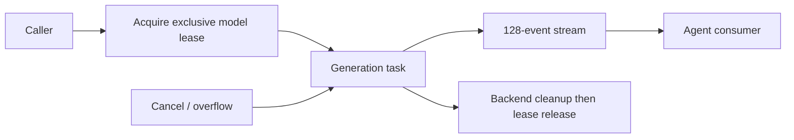

# Qwen3.5 chat adapter

Purpose: provide local text-only ChatCapability using pinned Qwen3.5 affine 4-bit weights and the independent MLX backend.

✅ Production uses Qwen3.5-2B 4-bit files from Models/Qwen35. The download profile pins the upstream revision; runtime loads the local directory directly.
✅ The injected ModelResource admits one active request and rejects concurrent calls; unload waits for generation cleanup. Each request starts with fresh cache state; history is supplied explicitly by the caller.
✅ Up to 64 messages / 64 KiB, 4096 prompt-plus-output tokens, no fixed output cap; omitted budgets may use the remaining local context. The output stream holds at most 128 events of 4096 bytes each; overflow fails explicitly.
✅ No automatic fallback. Physical Apple Silicon only. Load, warmup and unload are composition-root operations.
❌ Vision, native Tool Call transport and universal device compatibility are not implemented. Downloaded multimodal weights are consumed by MLX's text loader, which discards vision tensors; visual requests are not exposed.

Run scripts/download-qwen35.py before testing. The root project package declares this adapter; the base SDK does not depend on MLX or concrete models. Real quality and latency are acceptance measurements, separate from compilation and protocol-contract tests.

✅ The adapter takes a local directory. Optional 4B comparison files use Models/Qwen35-4B; HARNESS_QWEN35_SIZE=4B selects that directory in tests only.

## Queue and asynchronous processing contract

The Chat provider acquires one manager-owned ModelResource lease before generation; competing requests fail rather than wait. A generation task produces text/finished events; the Agent consumes the returned InferenceSession. Its stream holds 128 events, each at most 4096 estimated bytes. Overflow fails the session and terminates generation instead of dropping text and continuing. Request history belongs to the caller; it is not a queue retained by the model.

The session cancellation hook cancels the generation task. Worker cleanup releases its lease after backend work finishes; unload waits for that lease. Normal completion emits a finish reason and closes the stream; generation failures propagate through it. Blocking admission, automatic retries and persistent generation recovery are unsupported.

✅ The algorithm above describes the current implementation.

Maintenance: update this contract when changing producers, consumers, limits, ordering, cancellation or completion semantics.

## Managed lifecycle

✅ The factory receives ModelContext from the shared ModelManager. The adapter registers its resource and retains only a managed handle. Load/unload decisions belong to the manager; request completion releases usage without unloading. Shutdown cancellation is connected to the active session; resource release follows worker cleanup. Consumers keep their capability interface across weight unload/reload.

✅ The Defaults assembly calls configureCache(limitBytes:) before loading MLX models and chooses 64 MiB explicitly. The manager may evict idle Qwen weights on memory pressure; an existing ChatCapability handle reloads through its resource on the next inference.

✅ The Defaults assembly registers Qwen as chat and selects its resource directory. Capability consumers and App do not construct Qwen35Chat.

✅ Chat output-token budgets are optional and default to nil. Assistant/cloud requests omit max_tokens so the provider chooses its default; local Qwen uses remaining room in its existing 4096-token context. History shows 模型默认 for omitted values and preserves older explicit budgets. The separate 2000-byte whole-reply cap is removed; parser, queue, timeout and per-segment bounds remain. Explicit title/warmup budgets are unchanged. ❌ Live-provider/device acceptance remains separate.
