# Language generation

Purpose: define ChatCapability and provide local Gemma 4 E2B and OpenAI-compatible cloud adapters. Design goals: capability-only consumers, bounded output and independent backend execution.

- ✅ ChatCapability accepts caller-owned text conversation history and produces cancellable text, complete native Tool calls, optional token usage and completion events.
- ✅ Gemma4 implements the capability using the CoreAI backend; App selects its local model directory.
- ❌ Image inputs and local native Tool Call events.

Concrete adapters are separate Swift targets; the base SDK compiles only the capability contract here.

✅ OpenAI-compatible cloud text chat is a separate `ModelKitOpenAI` target in OpenAI/, sharing the shared capability/session contracts. ❌ Cloud chat supports bounded JPEG/PNG image input; video/audio chat modalities remain unimplemented.

✅ Chat output-token budgets are optional and default to nil. Assistant/cloud requests omit max_tokens so the provider chooses its default; local Gemma 4 E2B uses remaining room in its existing 4096-token context. History omits max tokens display and preserves older explicit budgets on disk. The separate 2000-byte whole-reply cap is removed; parser, queue, timeout and per-segment bounds remain. Explicit title/warmup budgets are unchanged. ❌ Live-provider/device acceptance remains separate.

## Native cloud Tool calls

✅ Cloud Chat Completions accepts JSON v6 function declarations and returns complete typed tool calls. ModelKit owns provider-neutral declaration bytes, provider call IDs, names and argument JSON; it imports no AgentCore types. Assistant resolves declared names through ToolCallParser and emits ToolCall through OutputGateway. Internal Tools are never exposed to the model. Local Gemma 4 E2B remains text-only.

```mermaid
flowchart LR
    JSON[Agent JSON v6 Tools] --> Request[ChatRequest tools]
    Request --> Cloud[Cloud request and SSE deltas]
    Cloud --> Join[Bounded per-index argument assembly]
    Join --> Call[Complete ChatEvent.toolCall]
    Call --> Resolve[AgentCore ToolCallParser and permission resolution]
    Resolve --> Gateway[OutputGateway / CallRuntime]
    Gateway --> Result[Existing InputGateway result feedback]
```

Declarations: at most 128, 64 KiB total. Cloud function names use a request-local safe name with an index suffix, mapped back to the declared name before emission; dotted registry paths never become provider identifiers. SSE aggregation admits at most 128 indices, 512-byte provider IDs, 64-byte names and 4096-byte string-object arguments per call, within the existing 8 MiB response bound. Calls are emitted only on tool_calls completion after all pending calls validate. Truncation, unknown names, malformed arguments and cancellation do not dispatch incomplete calls; there is no retry.

✅ Tool-only completion is accepted. Provider IDs remain in ModelKit events; Assistant creates runtime UUIDs for the existing ToolResult correlation contract. Text still uses the existing Action/wait parser. Returning Tools retain the current literal feedback behavior; completion-only Tools produce no result.
✅ Provider-neutral complete Tool transcripts are supported for bounded Agent-owned continuation. ❌ Local native tools, incomplete native transcripts and Responses API transport remain unsupported.

✅ Chat capability declarations now use member-level public access per strict Swift formatting. No capability semantics changed.

## Generation token usage

✅ ChatEvent.usage(ChatTokenUsage) reports nonnegative input/generated/total counts before the consumer's terminal finished event. Cloud counts come from provider usage; Gemma 4 E2B counts come from the actual template tokens and backend generation, including a consumed stop token. No AgentCore or Storage types enter ModelKit.
❌ Providers may omit usage, and failed/cancelled generations may have no final counts; callers must not estimate or substitute zero.

## Bounded registered-observation continuation

✅ Implemented: Assistant correlates generated Action/Tool calls with runtime-only feedback under the original turn, awaits complete results and requests the next model round. Limits: four total model rounds,16 native calls,64 KiB aggregate feedback/transcript and one30-second joined generation worker. A failed call becomes data for the model, never an automatic function retry. Cancellation clears owned feedback state and joins model cleanup; unknown/stale/duplicate feedback cannot resume a turn. Internal UI receipts and explicit /status retain their existing handling.

✅ Implemented: ModelKit ChatMessage gains provider-neutral assistant tool-call declarations and tool-result messages. OpenAI serializes request-local aliases consistently across declarations and prior calls; Gemma rejects native transcripts explicitly. Storage keeps optional exact text/native continuation JSON and metadata-only image descriptors as data, with bounded records and unchanged v1 compatibility. Camera native model calls use explicit observation registration so actual completion/error can continue reasoning. No change to camera or NexArm function implementation.

## Assistant photo observation — ADR0184

✅ Implemented: ChatMessage adds optional images preserving old transcript decoding; ChatRequest validates role/count/bytes separately from64KiB text. ChatCapability.supportsImages defaults false.

❌ Real camera/shutter/animation and configured-model vision acceptance remain pending; video recording and system Photos export are outside this iteration.
