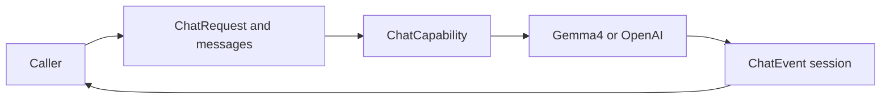

# Chat Requests and Provider Events

## Summary

Provider-neutral caller-owned conversation, image/native-call data and optional model-interface timing.

## Ownership and boundaries

ChatCapability generates data through cancellable sessions and advertises native/image support. Adapters own wire/token format and model bounds; Consumers own context selection, function resolution and task continuation.

## External relationships and data flow

The diagram shows runtime calls and data flow, not compilation dependencies.

## Public interfaces

ChatRequest retains InferenceContext, caller messages, optional output token budget, temperature, Tools and timing sampler. ChatMessage supports text, assistant native calls, tool results and JPEG/PNG ChatImage references/bytes as capability input. Image budget is at most four attachments/16 MiB total, four MiB each. Invalid pairing/images fail before execution.

ChatToolDefinition is a neutral function-envelope declaration; Responses flattens it. ChatToolCall identity/name/arguments is data, never execution authority. Native transcripts require complete original call/result pairing; unsupported local requests reject rather than pretending to execute/see images.

ChatTiming is one mutex-protected caller sampler per request. ✅ Providers sample monotonic request start and the first nonempty public text or validated native argument delta, whichever arrives first; consumers persist supplied evidence. Private reasoning, item creation and tool execution/completion are not first-token samples. Unsupported providers or streams without either delta retain absent timing. There is no automatic provider retry or application task loop in these values.

Typed chat/image/native-call contracts and optional timing are implemented.

## Related design

[Parent design](../README.md) · [Gemma4](Gemma4/README.md) · [OpenAI](OpenAI/README.md)

## Consecutive user message boundaries

Provider serialization preserves every original caller message boundary. Each caller user message keeps its original boundary and content; ChatRequest.messages remains authoritative. Providers retain their existing wire/token representation, input bounds and explicit unsupported-input failures. Responses reasoning parsing remains implemented. Role-order compatibility remains provider/model-specific.

## Request validation bounds

| Field | Bound / validation |
| --- | --- |
| Messages | 非空，最多 64 条；content 与 native ID/name/arguments 合计最多 65,536 UTF-8 字节。 |
| Native history | 只允许 assistant 声明 calls；ID 全请求唯一，结果逐项配对且 pending 集合最终为空；call ID/name/arguments 最多 512/64/4096 字节。 |
| Images | 只允许 user role；JPEG/PNG 非空，单张 ≤4 MiB，总计最多四张/16 MiB。 |
| Tools | 名称唯一，最多 128；定义分别及合计 ≤65,536 字节；中立 function envelope 必须有名称和参数对象。 |
| Generation options | temperature 为有限 0…2；显式 maximumOutputTokens 必须正数，nil 不设置输出预算。额外 provider 限制由适配器拥有。 |

非法请求在构造时抛出 invalidRequest，不补造配对或截断输入。保留调用者的消息边界和顺序；当前函数定义与历史调用名称集合独立。

## 待实现

- No additional implementation work is declared for the documented contract values. Provider-specific limitations are listed in the provider designs below.

✅ ChatTokenUsage 可选 cachedInput/cacheWriteInput，校验非负及不超过输入；缺失保持 nil。系统事实可单独置于上下文尾部，Gemma4 的首部规范化由其适配器负责。

## 分类异常诊断

✅ ChatCapability 定义 provider-neutral ChatFailureDiagnostic / ChatFailureProviding，区分 Tool 名称、身份、参数、事件顺序、完成/用量/流/HTTP/Provider 失败。诊断仅保留格式受限的协议标识、字段、索引及有界声明名称，不包含参数正文、消息、凭据或响应正文；不依赖 Agent/UI。

`ChatFailureProviding.chatFailure` 不包含异常对象或原始响应。公开原因按以下组划分；Agent 在代码前添加 `agent.model.`。

| 代码 | 含义 |
| --- | --- |
| `tool.undeclaredName` | 原生调用名称不在本请求声明中；含实际名称、最多8项允许名称及总数。 |
| `tool.invalidIdentity` | 缺失或不一致的 item/call/name 身份；field 定位具体项。 |
| `tool.invalidArguments` | 参数不是约定的字符串对象 JSON，或增量类型错误。 |
| `tool.argumentsMismatch` | 最终参数与已接收增量不一致。 |
| `tool.sequenceMismatch` | 重复、错序、未开始或终态不匹配的原生调用。 |
| `response.malformedEvent / invalidText / invalidItem` | SSE/UTF-8/事件 JSON、文本或输出 item 结构错误。 |
| `response.invalidCompletion / invalidUsage / invalidReasoning` | 响应终态、用量或私有 reasoning 元数据校验失败。 |
| `response.unsupportedOutput` | 不支持的事件/输出或拒绝结果。 |
| `response.invalidHTTP / contentType` | HTTP 响应对象或 MIME 类型错误。 |
| `stream.truncated / limitExceeded` | 流缺失终态/不完整，或达到原有容量限制。 |
| `transport / httpStatus / provider` | 连接失败、HTTP 状态或经过格式校验的服务端错误代码。 |

Stage 标识 http/framing/event/toolStart/toolArguments/toolEnd/completion/usage/reasoning；event、field、outputIndex 只在校验点可确定时出现。标识只接纳有界 ASCII 字母、数字及 `_.-`；非法/过长值用占位符表示，参数正文、用户消息、URL、Header 和凭据不进入诊断。
