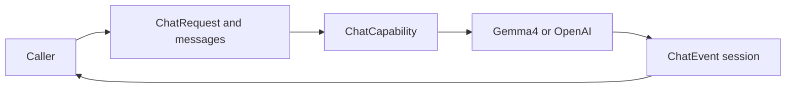

# Chat Requests and Provider Events

## Summary

Provider-neutral caller-owned conversation, image/native-call data and optional model-interface timing.

## Ownership and boundaries

ChatCapability generates data through cancellable sessions and advertises native/image support. Adapters own wire/token format and model bounds; Agents owns context selection, function resolution and task continuation.

## External relationships and data flow

Runtime arrows show data or capability calls; dashed arrows show injection.

## Public interfaces

ChatRequest retains InferenceContext, caller messages, optional output token budget, temperature, Tools and timing sampler. ChatMessage supports text, assistant native calls, tool results and JPEG/PNG ChatImage references/bytes as capability input. Image budget is at most four attachments/16 MiB total, four MiB each. Invalid pairing/images fail before execution.

ChatToolDefinition is a neutral function-envelope declaration; Responses flattens it. ChatToolCall identity/name/arguments is data, never execution authority. Native transcripts require complete original call/result pairing; unsupported local requests reject rather than pretending to execute/see images.

ChatTiming is one mutex-protected caller sampler per request. Providers report monotonic start and first nonempty text before emission; consumers persist supplied evidence. Native-only/unsupported timing remains absent. There is no automatic provider retry or Agent loop in these values.

✅ Typed chat/image/native-call contracts and optional timing are implemented.

## Related design

[Parent design](../README.md) · [Gemma4](Gemma4/README.md) · [OpenAI](OpenAI/README.md)
