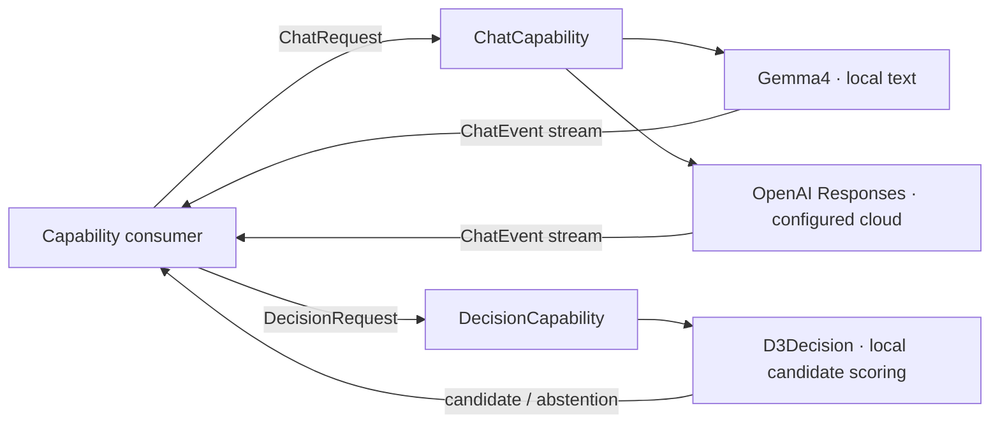

# Language Capability Contracts

## Responsibilities

Language owns provider-neutral conversation and candidate-selection interfaces. Chat consumers supply message history, prompts, tools and optional attachments. Decision consumers supply a question, current text and ordered candidates. The calling Agent owns continuation and interprets model output.

## Data flow

## Interfaces

[LLM](LLM/README.md) defines messages, images, native function declarations and results, text and usage events, dispatch timing and caller-owned transport observations. Providers publish capability constraints before native work. The local [Gemma4](LLM/Gemma4/README.md) fits an inference copy to its effective window. [OpenAI Responses](LLM/OpenAI/README.md) supports the configured cloud wire protocol and required tool choice.

[JEV](JEV/README.md) owns the Decision values and the D3 implementation in ModelKitD3. Candidate selection is a typed inference result. The caller interprets it and owns routing, interruption and fallback.

[ModelKit](../README.md)
