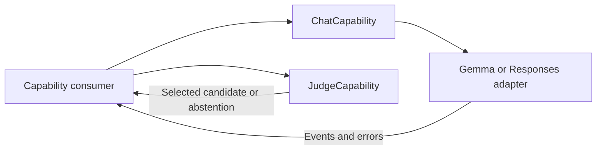

# Language Capability Contracts

✅ 已实现：Gemma 的本地窗口兼容归其 Provider，通用 ChatRequest 保留原文和调用方历史；云端不套用本地裁剪。

## Summary

Provider-neutral conversation generation and candidate-based judgment, independent of application decisions.

## Ownership and boundaries

Language owns request/result contracts. LLM adapters own provider encoding/tokenization; Consumers own prompts, tasks, callable selection and observation continuation. No Signal routing, effect execution or UI exists here.

## External relationships and data flow

The diagram shows runtime calls and data flow, not compilation dependencies.

## Interfaces

LLM defines context-bearing ChatRequest, messages/images/native function data, ChatEvent and optional caller-owned timing. Native calls are inert model data until an authorized consumer resolves them. Judgment defines unique candidates and bounded optional scores without selecting application actions.

Adapters advertise native-call/image support explicitly and reject unsupported payloads before native work. Caller-owned history is authoritative. Decisions/continuations use new requests; the capability does not retain application task state.

Conversation and judgment contracts are implemented.

## Related design

[Parent design](../README.md) · [JEV](JEV/README.md) · [LLM](LLM/README.md)

## 待实现

- A concrete judgment provider is not implemented.

✅ 中立用量保留缓存读取/写入的可选输入 token 数；消息可包含多条 system，具体 provider 保留语义并适配模板。

✅ 本地Gemma在ModelKit内按后端有效窗口适配，当前iOS缓存安全限制比4096更小；接口及算法见 [Gemma4](LLM/Gemma4/README.md)。

✅ 按用户要求，本地Gemma排查版本移除所有system，仅保留有界对话输入；云端及通用请求不变，详见Gemma4目录契约。
